# Deterministic Police Queue Sorting & Unified Officer Audit Trail

*   **Author:** BrahimMasmoudi
*   **Status:** Proposed
*   **Date:** 2026-11-24

--------------------------------------------------------------------------------

## Overview

This design resolves two operational gaps in the `/police` enforcement dashboard:

1. **Unordered pending queues**: Car activations, deletion requests, ownership transfers, and field reports currently appear in document-ID order instead of chronological request order, while pending disputes truncate after 50 newest rows. This design sorts all five actionable police queues deterministically oldest-first by queue-specific request timestamps (defined in Section 2) so stalled requests appear at the top of each queue, displays relative wait ages, and provides an in-UI sort toggle.
2. **Incomplete officer accountability in Audit**: The `Audit` tab currently reads only the `fines` collection, omits which officer issued or resolved each fine, and excludes car decisions and dismissed reports. This design replaces that eager fine listener with a lazy-loaded, officer-attributed `Decision Log` across car decisions, fine issuances, dispute resolutions, and dismissed reports, while preserving paid-fine receipt verification via on-demand lookup by `fineId` or `paymentReference`.

## The Problem

1. **Pending requests appear in document-ID order**: In `front/app/stores/cars.ts`, `pendingCarsRef` fetches pending vehicles with no `orderBy`. Because new `cars` documents use the normalized license plate as their document ID, pending activations, deletions, and transfers appear in alphabetical plate order rather than chronological request order. In `front/app/stores/reports.ts`, `pendingReportsQuery` also lacks `orderBy`, returning pending field reports (submitted by field enforcement `agent` users) in arbitrary auto-ID order.
2. **Silent truncation of older pending disputes**: In `front/app/stores/fines.ts`, `pendingDisputesQuery` uses `orderBy('disputedAt', 'desc')` with `limit(50)`. If more than 50 disputes are pending at once, the oldest unresolved disputes fall past item 50 and disappear from the police table.
3. **Misleading timestamps on car deletions and transfers**: `PoliceCarsTab.vue` and `PoliceCarReviewModal.vue` bind `createdAt` (the vehicle's original registration date) for all three car queues (`activations`, `deletions`, and `transfers`), hiding when the deletion or police transfer review was requested.
4. **No unified officer accountability when owners contest decisions**: Although backend use cases write `actorId` to two server-only collections (`enforcement_audit_logs` and `car_audit_logs`), both collections are unreadable by clients under `firestore.rules`. Meanwhile, `PoliceAuditTab.vue` only displays `fines`, and `cars` documents do not retain prior officers across owner retries or transfers. When an owner contests a rejected car, a dismissed report, or an issued fine, police officers cannot look up which officer made the decision in the dashboard.
5. **Eager unbounded `fines` reads on `/police` load**: `finesStore.allFinesQuery` opens a real-time listener over the entire `fines` collection with no limit whenever an officer loads `/police`, even when the `Audit` tab is never opened.

## Goals

*   Sort all five actionable police queues (`activation_pending`, `deletion_requested`, `transfer_pending_police`, pending `reports`, and pending `disputes`) deterministically oldest-first using queue-specific request timestamps, with a per-tab toggle to reverse loaded queue order, so requests do not remain in document-ID order or hidden behind a 50-item newest-first cutoff.
*   Stop fetching `transfer_pending_owner` in the police pending-cars listener, and display queue-specific request timestamps and wait ages in each queue table, and in `PoliceCarReviewModal.vue` for car requests.
*   Provide a lazy-loaded, cursor-paginated `Decision Log` in the `Audit` tab showing which officer performed recorded police decisions across vehicle activations, deletions, and transfers, dismissed field reports, issued fines, and dispute resolutions. Support category filtering, dedicated full-history plate search, live client-side filtering of loaded entries, and on-demand receipt lookup by `fineId` or `paymentReference`.
*   Preserve the existing paid-fine receipt verification workflow (`PoliceReceiptModal`) from the `Audit` tab without exposing owner cardholder PII (`fines/{fineId}/receipt/summary`).

## Non-Goals

*   Adding a header notification menu, general "new row" toast alerts, or blinking tab count badges.
*   Adding passive `seenBy` read receipts on modal open or active `assignedTo` locking/takeover workflows.
*   Replacing or redesigning the existing car approval, report fining/dismissal, or dispute resolution modals beyond displaying queue-specific timestamps and wait ages.
*   Fixing the pre-existing UI bug where cancelling a deletion invokes vehicle activation instead of deletion cancellation (the backend activation handler rejects non-`activation_pending` vehicles before writing audit logs).
*   Exposing owner-only card metadata (`cardholderName`, `cardBrand`, `cardLast4` under `fines/{fineId}/receipt/summary`) in police audit logs or modals.

## Critical User Journeys (CUJs)

### CUJ 1: Officer Reviews Pending Requests Without Missing Stalled Items

*   **Given**: Multiple vehicles are awaiting activation, deletion, or police-stage transfer approval, and agents have submitted pending reports or owners have filed fine disputes over several days.
*   **When**: A police officer opens `/police` and inspects the `Cars`, `Reports`, and `Disputes` tabs.
*   **Then**: Each queue appears in oldest-first chronological order (with a per-tab toggle to reverse the loaded items locally), displays its queue-specific request timestamp and wait age, excludes transfers still waiting on the current owner, and surfaces pending disputes beyond the prior 50-item newest-first cutoff (showing up to the oldest 250 pending reports/disputes with a `250+` notice when capped).

### CUJ 2: Officer Investigates a Contested Car, Report, or Fine Decision

*   **Given**: An owner contests why a vehicle registration was rejected, why a transfer was denied, why a parking report was dismissed, or who issued or resolved a fine.
*   **When**: An officer opens the `Audit` tab on `/police`, filters by decision category (`All`, `Cars`, `Reports`, `Fines & Disputes`), submits a license plate in the dedicated full-history plate search, or narrows loaded entries with the in-tab text filter.
*   **Then**: Submitting a normalized plate returns matching decisions across the entire decision log ordered newest-first (searching effective/issued plates), while the loaded-row text filter matches person names, reasons, normalized plates, and original reported plates within currently loaded rows. Each row displays the timestamp, decision type, plate, owner name (or `—` when unregistered), acting officer's name, and any recorded reason.

### CUJ 3: Officer Verifies a Settled Fine Receipt from the Audit Tab

*   **Given**: A fine has been settled (`paid`) by the vehicle owner.
*   **When**: The officer locates an issued fine or dismissed dispute entry in `Decision Log` and clicks **View Receipt**, or submits a fine ID or payment reference (`PA-...`) in the receipt lookup input.
*   **Then**: The client fetches the fine record on demand and opens the receipt modal with the settled payment metadata (`paymentReference`, `fineId`, `paidAt`, `amount`) without accessing private cardholder summary subdocuments, or displays a toast if the fine is unpaid, cancelled, or not found.

--------------------------------------------------------------------------------

## Technical Plan (Architecture)

### 1. System Data Flow

```mermaid
flowchart LR
    subgraph PendingQueues["Pending Queues (FIFO Default + Local Toggle)"]
        CarsQ["cars queue (client sort)"]
        ReportsQ["reports queue (orderBy timestamp asc, limit 250)"]
        DisputesQ["fines dispute queue (orderBy disputedAt asc, limit 250)"]
    end

    subgraph PoliceUI["/police Dashboard"]
        CarsTab["PoliceCarsTab + PoliceCarReviewModal"]
        ReportsTab["PoliceReportsTab"]
        DisputesTab["PoliceDisputesTab"]
        AuditTab["PoliceAuditTab (self-contained lazy tab)"]
        ReceiptModal["PoliceReceiptModal (fine metadata only)"]
    end

    subgraph BackendUsecases["Cloud Functions (TransactionRunner)"]
        CarMut["ApproveCar / RejectCar / ApproveCarDeletion / ApproveTransfer / RejectTransfer"]
        RepMut["DismissReport"]
        FineIss["IssueFine"]
        FineRes["ResolveDispute"]
    end

    subgraph Firestore["Firestore Collections"]
        CarLogs["car_audit_logs (server-only)"]
        EnfLogs["enforcement_audit_logs (server-only)"]
        PoliceLogs["police_audit_logs (police read-only, write: false)"]
        CarsCol["cars"]
        ReportsCol["reports"]
        FinesCol["fines"]
        UsersCol["users (batched UID lookup)"]
    end

    CarsCol -->|"onSnapshot"| CarsQ --> CarsTab
    ReportsCol -->|"onSnapshot"| ReportsQ --> ReportsTab
    FinesCol -->|"onSnapshot"| DisputesQ --> DisputesTab

    CarsTab -->|"httpsCallable"| CarMut
    ReportsTab -->|"httpsCallable"| RepMut
    ReportsTab -->|"httpsCallable"| FineIss
    DisputesTab -->|"httpsCallable"| FineRes

    CarMut -->|"Atomic tx write"| CarsCol
    CarsCol -->|"Read cars (incl. rejected/archived)"| RepMut
    RepMut -->|"Atomic tx write"| ReportsCol
    FineIss -->|"Atomic tx write"| ReportsCol & FinesCol
    FineRes -->|"Atomic tx write"| ReportsCol & FinesCol

    CarMut -->|"Atomic tx write"| CarLogs
    RepMut & FineIss & FineRes -->|"Atomic tx write"| EnfLogs
    CarMut & RepMut & FineIss & FineRes -->|"Atomic tx write"| PoliceLogs

    PoliceLogs -->|"Paginated getDocs (limit 50 + cursor)"| AuditTab
    FinesCol -->|"On-demand fineId / PA-... lookup"| AuditTab
    UsersCol -->|"Batched documentId in [...]"| CarsTab & DisputesTab & AuditTab
    AuditTab --> ReceiptModal
```

### 2. Pending Queue Ordering & Car Timestamps

1. **Reuse existing `cars` queue timestamps**:
   * **Car queue entry lifecycle**:
     * `activation_pending`: Registration writes `createdAt = serverTimestamp()`; on subsequent rejection retry, `FirestoreCarRepository.update` sets `updatedAt = serverTimestamp()`, ordering retried submissions by latest resubmission time so stale rejected drafts do not jump ahead of recent requests.
     * `deletion_requested`: Deletion requests write `deletionRequestedAt` and set `updatedAt = serverTimestamp()`.
     * `transfer_pending_police`: Ownership transfers first enter `transfer_pending_owner` with `transferRequestedAt`, then move to `transfer_pending_police` on owner acknowledgement (`updatedAt = serverTimestamp()`). Using `updatedAt ?? transferRequestedAt ?? createdAt` measures wait time from entry into the police queue while supporting legacy records.
   * **Optional timestamp parsing**: In `front/app/stores/cars.ts`, `carConverter` parses optional `updatedAt`, `deletionRequestedAt`, and `transferRequestedAt` via an optional timestamp parser returning `undefined` when absent (never falling back to `Date.now()` as `getTimestampMillis` does, which would block `?? createdAt` fallbacks).
   * **Shared queue timestamp resolver**:
     * `'activation'`: `updatedAt ?? createdAt`
     * `'deletion'`: `deletionRequestedAt ?? updatedAt ?? createdAt`
     * `'transfer'`: `updatedAt ?? transferRequestedAt ?? createdAt`
   * **Frontend subscription**: `front/app/stores/cars.ts` narrows `pendingCarsRef` to `['activation_pending', 'deletion_requested', 'transfer_pending_police']` (omitting `'transfer_pending_owner'` and removing unused `transferPendingOwnerCars`). Because `pendingCarsRef` spans three sub-queues whose legacy documents may lack optional queue timestamps (`orderBy` would omit docs missing the ordered field), `PoliceCarsTab.vue` sorts each filtered queue locally using the queue timestamp resolver and ascending document ID tie-breaker.

2. **Bounded `reports` and `disputes` queue queries (fixed `asc`, local sort toggle)**:
   * `front/app/stores/reports.ts` subscribes to `where('status', '==', 'pending'), orderBy('timestamp', 'asc'), limit(250)`.
   * `front/app/stores/fines.ts` subscribes to `where('disputeStatus', '==', 'pending'), orderBy('disputedAt', 'asc'), limit(250)`.
   * Fixing the store queries to ascending order prioritizes the oldest 250 indexed items at the head of each queue without tearing down or re-subscribing listeners on toggle, keeping tab counts and client filtering stable and removing permanent dual-index requirements.
   * When an unfiltered store queue reaches 250 items, the tab badge renders `250+` and the tab displays a cap banner noting that only the oldest 250 pending items are shown (and reversed locally when toggled) while items beyond #250 wait behind queue resolution.

3. **Uniform UI sorting toggle and wait-age display**:
   * All three queue tabs (`PoliceCarsTab.vue`, `PoliceReportsTab.vue`, `PoliceDisputesTab.vue`) hold local sort-direction state (defaulting to oldest-first) and sort their loaded arrays in memory with deterministic ascending document-ID tie-breakers, keeping `police/index.vue` free of sort-state plumbing. (Rename vehicle requested-time column/slot keys cleanly from `createdAt` to `requestedAt`.)
   * `PoliceCarsTab.vue` and `PoliceCarReviewModal.vue` display the queue-specific request timestamp and relative wait-age badge instead of vehicle registration `createdAt`.
   * Pending rows across all three queue tabs render a relative wait-age badge alongside the timestamp, highlighted in amber warning styling once wait duration reaches 24 hours.

### 3. Unified Officer Audit Trail (`police_audit_logs`)

1. **Document schema (`police_audit_logs/{logId}`)**:
   * `id`: Firestore auto-generated ID
   * `targetType`: `'car' | 'report' | 'fine'`
   * `targetId`: `string` (`carId`, `reportId`, or `fineId`)
   * `actorId`: `string` (authenticated police officer UID)
   * `ownerId`: `string` (vehicle or fine owner UID; `''` if a dismissed report has no eligible non-archived, non-rejected vehicle; `newOwnerId` for `TRANSFER_APPROVED`; `car.ownerId` for `TRANSFER_REJECTED`)
   * `plateNumber`: `string` (formatted display plate, or `''` for plate-less dismissed reports)
   * `plateNumberNormalized`: `string` (`normalizePlate` output from shared plate utilities: uppercased alphanumeric string, or `''` when no alphanumeric characters remain)
   * `action`: `'CAR_APPROVED' | 'CAR_REJECTED' | 'CAR_DELETION_APPROVED' | 'TRANSFER_APPROVED' | 'TRANSFER_REJECTED' | 'DISMISS_REPORT' | 'ISSUE_FINE' | 'CANCEL_FINE' | 'DISMISS_DISPUTE'`
   * `reason`: `string | null` (rejection reason, dismissal reason, fine notes, or dispute resolution reason)
   * `metadata`: optional `{ originalPlateNumber?: string }` (earliest recorded plate before corrections)
   * `timestamp`: Firestore `serverTimestamp()`

2. **Backend transactional writes (`PoliceAuditPort` & `PoliceAuditHelper`)**:
   * Introduce `PoliceAuditPort` (`addLog(entry, tx)`) requiring an active `TransactionContext` (obtained via `TransactionRunner` using the shared `FirestoreConnector` `connector` from `functions/src/infrastructure/entry-points/index.ts`).
   * Implement `PoliceAuditHelper` targeting `police_audit_logs`, validating the unwrapped Firestore transaction before calling `create`, stripping nested `undefined` keys (preserving `null`), and writing `timestamp: serverTimestamp()`. Existing `CarRepository` and `EnforcementAuditPort` interfaces and implementations remain untouched.
   * Require `policeAuditPort: PoliceAuditPort` on all eight police decision use cases:
     * **Car use cases**: `ApproveCarUseCase` (`CAR_APPROVED`), `RejectCarUseCase` (`CAR_REJECTED`), `ApproveCarDeletionUseCase` (`CAR_DELETION_APPROVED`), `ApproveTransferUseCase` (`TRANSFER_APPROVED`, with `ownerId: car.transferToOwnerId`), and `RejectTransferUseCase` (shared state machine across `transfer_pending_owner` and `transfer_pending_police`, emitting `TRANSFER_REJECTED` only on `transfer_pending_police` with `ownerId: car.ownerId`), computing `plateNumberNormalized` as `car.plateNumberNormalized || normalizePlate(car.plateNumber)` for legacy records.
     * **Report dismissal (`DismissReportUseCase`, `DISMISS_REPORT`)**:
       * Keep `collectPlateOwnerIds` unchanged in `user-authorization.ts` for `IssueFineUseCase`.
       * Inside `DismissReportUseCase`, query `carRepository.getAllByPlateNumber(..., tx, { includeRejected: true, includeArchived: true })` directly before `reportRepository.update`, deduplicating `[report.plateNumber, report.originalPlateNumber]` by `normalizePlate` and skipping empty normalized strings.
       * Pass all collected `ownerId`/`transferToOwnerId` values into `assertNotSelfEnforcement` (preventing officers from acting on reports involving vehicles they own or are receiving via transfer).
       * Derive `ownerId` from cars returned for `report.plateNumber` excluding `archived` and `rejected` vehicles, preferring `active` first, falling back to the first remaining eligible vehicle's `ownerId`, and defaulting to `''` only when none exists. Guard empty normalized plates cleanly.
     * **Fine issuance (`IssueFineUseCase`, `ISSUE_FINE`)**: Promote `enforcementAuditPort` to required alongside `policeAuditPort`; log `metadata.originalPlateNumber` (`earliestOriginal`, prioritizing `report.originalPlateNumber` over `report.plateNumber` when corrected by an officer).
     * **Dispute resolution (`ResolveDisputeUseCase`, `CANCEL_FINE` / `DISMISS_DISPUTE`)**: Log `reason` using validated `fineId` as `targetId` (noting that `CANCEL_FINE` also updates any linked `report` inside the same transaction).
   * Existing `car_audit_logs` and `enforcement_audit_logs` collections remain unchanged and server-only.

3. **Security rules & indexes**:
   * `firestore.rules` (authored via `firestore-rules-author` and audited via `firebase-security-rules-auditor`): add `match /police_audit_logs/{logId}` with `allow read: if isSecureRequest() && hasRole('police'); allow write: if false;` (`isSecureRequest()` checks authentication; `hasRole('police')` checks `users/{uid}.roles`).
   * `firestore.indexes.json`:
     * Add `(status ASC, timestamp ASC)` on `reports` and `(disputeStatus ASC, disputedAt ASC)` on `fines`. Retain the legacy `DESC` indexes temporarily during rollout so in-flight older clients do not hit `failed-precondition` errors.
     * Add `(targetType ASC, timestamp DESC)`, `(plateNumberNormalized ASC, timestamp DESC)`, and `(plateNumberNormalized ASC, targetType ASC, timestamp DESC)` on `police_audit_logs`. Single-field `paymentReference` lookups use Firestore's automatic single-field index.

4. **Self-contained, lazy-loaded `Audit` tab & receipt verification**:
   * **Remove eager fine reads**: Remove `allFinesQuery` from `front/app/stores/fines.ts` along with the `Audit` tab count badge and audit table logic from `front/app/pages/police/index.vue`.
   * **Store dual gating & lifecycle**: `usePoliceAuditStore` enforces the same auth/role/route gating (`authStore.currentUser?.uid && userStore.hasRole('police') && route.meta.role === 'police'`) used by `cars.ts`, `reports.ts`, and `fines.ts` (auto-resetting if gating fails), preserves cursor pagination via `QueryDocumentSnapshot` across `Audit` tab revisits once `hasLoaded` succeeds, provides an explicit **Refresh** action, and coordinates async calls with a monotonic request token so stale responses cannot overwrite newer queries.
   * **Tab encapsulation**: `PoliceAuditTab.vue` receives only `active: boolean` from `police/index.vue` (`<UTabs>` disables unmount-on-hide), triggering initial lazy page-1 load once on activation and resetting on unmount.
   * **Segmented Audit plate search vs. loaded-row filter**:
     * Hide `MoleculesPoliceSearchBar` (the shared dashboard queue search bar) when `activeTab === 'audit'`.
     * Provide a dedicated **Search Plate** form (`Search Plate` + **Clear**) normalizing input via `normalizePlate` (`~/composables/useVehicleValidation`) and querying full `police_audit_logs` history across `(plateNumberNormalized, optional targetType)` ordered newest-first in pages of 50 (working for all registered plate formats; searches effective/issued `plateNumberNormalized`).
     * Provide a separate live **Filter loaded rows** input (no submit action) filtering loaded entries client-side across `plateNumber`, `plateNumberNormalized` (matching unhyphenated plate text), `metadata?.originalPlateNumber` (raw and normalized), hydrated actor/owner names, and `reason`, displaying a loaded-rows scope notice when active outside plate-search mode.
     * Category pills, **Refresh**, and **Load more** operate uniformly over whichever mode (feed or plate search) is active.
   * **Explicit Receipt Lookup (`Find Receipt`)**:
     * Provide an explicit lookup form submitting trimmed `PA-...` (`paymentReference`, uppercased only for `PA-` prefixes, queried with `limit(1)`) or case-preserved `fineId` to `finesStore`, plus a **View Receipt** button on `ISSUE_FINE` and `DISMISS_DISPUTE` rows (noting that clicking **View Receipt** triggers one on-demand `fines/{fineId}` read even if unpaid or cancelled).
     * Opening `PoliceReceiptModal` checks `status === 'paid'`, never reads `fines/{fineId}/receipt/summary`, ignores blank submissions, and distinguishes missing (`receipt_not_found`) vs. unpaid/cancelled (`receipt_not_paid`).
   * **Unified batched user display names**:
     * Consolidate `userStore.fetchUsers(uids)` (`where(documentId(), 'in', chunk)` in batches of 30) with a promise `Map<string, Promise<void>>` so concurrent `fetchUsers` and `await fetchUser(uid)` callers share and await active fetches rather than returning prematurely.
     * Update `police/index.vue` pending car and dispute watchers from per-item `fetchUser` loops to batched `fetchUsers(uids)`, aligning pending car queues, pending dispute queues, and `Audit` on one hydration path (reports do not display owner names).
     * Diff returned `QuerySnapshot` document IDs against each batch to cache `{ name: 'Unknown User' }` only for non-existent user docs, clear temporary loading markers on transient failures without caching `'Unknown User'` so retries succeed, and display `—` when `ownerId` is empty.

### 4. Historical Backfill Migration

Add an idempotent `Fireway` migration script (`functions/migrations/v6__backfill_police_audit.ts`) run **after** all audit-writing Cloud Functions finish deploying. Validate `POLICE_AUDIT_CUTOFF_ISO` inside `migrate()` (captured at least 60s after deploy completion so future `v7+` runs and clock skew stay safe), filter source logs to `timestamp < cutoffTimestamp`, and deduplicate the rolling-deploy overlap window by querying `police_audit_logs` once for `timestamp >= rolloutStart` (optional `POLICE_AUDIT_ROLLOUT_START_ISO`, defaulting to `cutoff - 1h`) and matching `(targetType, targetId, action, actorId, timestampMs)` against Firestore's transactionally shared `serverTimestamp()` values before writing deterministic `enf_<id>` / `car_<id>` docs:
*   **Source collection schemas**:
    *   `car_audit_logs`: `{ id?, carId, actorId, action, details?, reason?, timestamp }`
    *   `enforcement_audit_logs`: `{ id?, targetType: 'report' | 'fine', targetId, actorId, action, originalPlate?, issuedPlate?, reason?, paymentReference?, paymentProvider?, timestamp }`
*   **Migration execution**:
    1.  Scan `enforcement_audit_logs` and `car_audit_logs` via `orderBy(FieldPath.documentId())` in pages of 450, keeping relevant police actions (`APPROVED -> CAR_APPROVED`, `REJECTED -> CAR_REJECTED`, `DELETION_APPROVED -> CAR_DELETION_APPROVED`, `TRANSFER_APPROVED`, `TRANSFER_REJECTED`, `DISMISS_REPORT`, `ISSUE_FINE`, `CANCEL_FINE`, `DISMISS_DISPUTE`) with `timestamp < cutoffTimestamp`.
    2.  Batch-fetch referenced `reports`, `fines`, `cars`, and `users` per page via chunked `firestore.getAll(...)` (pruning target caches after each page while retaining bounded `users` role cache across pages). For `DISMISS_REPORT`, query `cars` in chunks of 30 via `where('plateNumberNormalized', 'in', chunk)` with `cars/{normalized}` document-ID fallback (for legacy vehicle records lacking `plateNumberNormalized`), excluding `archived` and `rejected` cars and preferring `active`, then the first remaining eligible vehicle, else `''`.
    3.  Disambiguate `TRANSFER_REJECTED` via `actor?.roles?.includes('police') && actorId !== car?.ownerId && !(car?.ownershipHistory ?? []).includes(actorId)` (preserving dual-role `['police', 'owner']` officers acting as police; `ownerId: car?.ownerId ?? ''`).
    4.  Parse `TRANSFER_APPROVED` `details` (`Transferred from <prev> to <new>`) solely to set `ownerId` (`newOwnerId || car?.ownerId || ''`) when a transferred vehicle later changed owners again.
    5.  Skip any record matching the rollout overlap dedup set, map historical `actorId`, `targetId`, `reason`, `metadata.originalPlateNumber` (normalizing `enfLog.originalPlate` before comparing against issued `plateNumberNormalized`), and deleted targets deterministically (skipped `DISMISS_REPORT`/`CANCEL_FINE`/`DISMISS_DISPUTE` if target missing; `carId` fallback with `ownerId: ''` for deleted cars; `enfLog.issuedPlate` fallback with `ownerId: ''` for deleted `ISSUE_FINE` fines), preserve source `timestamp`, and write `enf_<id>` / `car_<id>` via `batch.set(...)`.

--------------------------------------------------------------------------------

## Alternatives Considered

### Alternative A: Header Notification Menu + Toast Alerts on New Table Rows

*   **Pros**: Highlights live row arrivals regardless of which tab the officer is viewing.
*   **Cons**: Initial Firestore `useCollection` snapshots populate all existing pending rows on page load, requiring snapshot-diff suppression; firing repeated toast notifications during initial load and busy shifts obscures UI controls.
*   **Reason for Rejection**: Toast volume during initial snapshot load and snapshot-diff complexity outweigh live notification benefits when oldest-first queues already list stalled items at the top of each tab.

### Alternative B: Blinking Tab Badge Numbers

*   **Pros**: Minimal UI change that draws attention to the existing tab counts in `/police`.
*   **Cons**: Only works for additions detected while `/police` is already open; requests submitted before the officer logs in do not trigger blinking, missing pre-login pending requests.
*   **Reason for Rejection**: Misses pre-login backlogs on tabs that already expose numeric queue counts.

### Alternative C: Passive `seenBy` Tracking on Details Modal Open

*   **Pros**: Records which officer first opened a pending car, report, or dispute.
*   **Cons**: Because `firestore.rules` sets `allow write: if false` on client writes, every modal open would require a Cloud Function write; accidental modal opens could also mark a still-unhandled item as "seen" and cause teammates to skip it.
*   **Reason for Rejection**: Inspection reads must remain write-free and must not mark unresolved work as handled.

### Alternative D: Active `assignedTo` Claiming + Takeover Notifications

*   **Pros**: Explicitly tracks which officer owns a pending request in progress.
*   **Cons**: Introduces new claim/release Cloud Functions, schema fields across three collections, and stale-lock risks if an officer claims an item and goes offline before finishing it (alongside needing a takeover notification channel).
*   **Reason for Rejection**: Coordination and stale-lock overhead is disproportionate for single-step approval/rejection reviews.

### Alternative E: Newest-First (`desc`) Default Pending Queue Ordering

*   **Pros**: Places the most recently submitted request at row 1 immediately.
*   **Cons**: Under steady incoming traffic, newly arrived requests continually push older pending requests down the table (and past any query `limit`), delaying review of older requests.
*   **Reason for Rejection**: Chronological oldest-first (`asc`) default places stalled requests at the top of each queue while permitting local reverse-order inspection on demand.

### Alternative F: Fines-Only Audit Tab or Direct Client Reads of `cars`, `reports`, and `fines`

*   **Pros**: `fines` documents already persist `issuedBy` and `resolvedBy`, avoiding new backend audit projections.
*   **Cons**: Leaves car approvals, rejections, deletions, transfers, and dismissed reports untraceable in the `/police` dashboard when an owner contests a decision. Furthermore, `cars/{carId}` does not record the acting officer for activations/transfers and overwrites state on retries and subsequent transfers.
*   **Reason for Rejection**: All eight audited police decision types (car decisions, dismissed reports, issued fines, and dispute resolutions) must be traceable in Audit without losing prior decisions across entity state changes.

### Alternative G: Extending `enforcement_audit_logs` or Merging `car_audit_logs` Client-Side

*   **Pros**: Reuses existing audit collections without introducing `police_audit_logs`.
*   **Cons**: Client-side merging of two Firestore collections breaks cross-collection cursor pagination, and legacy `car_audit_logs` entries lack `plateNumberNormalized`, derived `ownerId`, and transfer-stage disambiguation. Extending `enforcement_audit_logs` directly mixes server-internal owner/agent lifecycle events with police UI logs.
*   **Reason for Rejection**: A dedicated `police_audit_logs` projection keeps police reads isolated and cursor-paginated in a single query.

### Alternative H: Separate Paginated `Fines & Receipts` Sub-View in `Audit`

*   **Pros**: Provides a dedicated browsable list filtered purely by fine payment status (`paid` / `unpaid`).
*   **Cons**: Duplicates pagination state, composite indexes, and fine rendering over the same fine issuance and dispute decisions already present in `Decision Log`.
*   **Reason for Rejection**: On-demand `fetchFineById` / `fetchFineByPaymentReference` receipt lookup preserves receipt verification without maintaining a second paginated table.

### Alternative I: Forward-Only Audit Logs (No Backfill)

*   **Pros**: Avoids writing and running a `v6` migration script.
*   **Cons**: Leaves pre-deployment car decisions, dismissed reports, and fines invisible in `Decision Log` when owners contest historical actions.
*   **Reason for Rejection**: A deploy-cutoff backfill preserves historical accountability in `Decision Log` without touching live workflows.

### Alternative J: Custom `pendingSince` Field on `cars`

*   **Pros**: Would allow a single server-side `orderBy('pendingSince')` query across all three car sub-queues if paired with a server limit.
*   **Cons**: Because `pendingCarsRef` already loads and splits the three car sub-queues client-side, adding `pendingSince` requires modifying the car repository, all car lifecycle use cases, Cloud Function entry points, and backfilling existing `cars` documents with zero read savings.
*   **Reason for Rejection**: Reusing `updatedAt`, `deletionRequestedAt`, `transferRequestedAt`, and `createdAt` avoids repository, use-case, entry-point, and vehicle-backfill churn while delivering equivalent oldest-first queue ordering for current car lifecycle transitions without adding a `pendingSince` field.

### Alternative K: Snapshotting User Names on `police_audit_logs`

*   **Pros**: Avoids client `users` reads when rendering `Decision Log`.
*   **Cons**: Forces extra `users/{ownerId}` reads inside backend transactions (for example in `DismissReportUseCase`) and stores point-in-time display names that become stale if an officer updates their profile.
*   **Reason for Rejection**: Batching `userStore.fetchUsers` reads keeps display names current without adding backend transaction reads.

### Alternative L: Asynchronous `onDocumentCreated` Trigger Projection for `police_audit_logs`

*   **Pros**: Keeps the eight domain use cases decoupled from projecting `police_audit_logs`.
*   **Cons**: Introduces eventual consistency (an officer navigating from `Cars`/`Reports`/`Disputes` to `Audit` may not see the action they just performed), adds trigger cold starts and retry handling, and still requires `RejectTransferUseCase` to persist stage metadata on `car_audit_logs`.
*   **Reason for Rejection**: Synchronous transactional writes inside `TransactionRunner` ensure immediate Firestore visibility on the next `Audit` query (initial tab open or explicit **Refresh**) without eventual-consistency delay.

--------------------------------------------------------------------------------

## Non-Functional Requirements

*   **Security & PII Isolation**: `police_audit_logs` allows `read` only for authenticated users with the `police` role and denies all client writes (`allow write: if false`). Paid-fine receipt verification from `Audit` reads only `fines/{fineId}` and never reads `fines/{fineId}/receipt/summary`.
*   **Read Cost & Pagination**: Removing `allFinesQuery` eliminates eager unbounded `fines` reads on `/police` load when `Audit` is not opened. `reports` and `disputes` pending queues are bounded to `limit(250)` (`pendingCarsRef` remains unbounded until active pending vehicles exceed 250, requiring backfilled queue timestamps and per-status splitting). `Decision Log` (`police_audit_logs`) loads lazily on first `Audit` tab open in pages of 50 documents with cursor pagination (`startAfter`), and user profile hydration batches UIDs in chunks of 30.
*   **Migration Idempotency**: `v6__backfill_police_audit.ts` writes deterministic document IDs (`enf_<id>`, `car_<id>`), bounded by post-deploy `POLICE_AUDIT_CUTOFF_ISO` and rollout-window timestamp-key deduplication so repeated runs neither drop rollout-window events nor duplicate live auto-ID logs.

## Risks & Mitigations

*   **Index rollout ordering (`failed-precondition`)**: Switching queries to `asc` before `firestore.indexes.json` finishes building, or removing legacy `DESC` indexes still queried by in-flight clients, causes `failed-precondition` errors. **Mitigation**: Deploy `firestore.indexes.json` and `firestore.rules` before deploying frontend queries, and retain legacy `DESC` indexes during initial rollout until all active clients upgrade.
*   **Migration vs. Functions deployment race**: Running `v6` before Functions finish deploying misses interim events; writing auto-IDs in live Functions alongside a post-deploy cutoff risks duplicating events committed inside the rollout window. **Mitigation**: Capture `POLICE_AUDIT_CUTOFF_ISO` >= 60s **after** the audit-writing Cloud Functions finish deploying, query existing `police_audit_logs` from the rollout window start (sharing exact transactional `serverTimestamp()` values with `car_audit_logs` / `enforcement_audit_logs`), and skip matching `(targetType, targetId, action, actorId, timestampMs)` tuples before writing `enf_<id>` / `car_<id>`.
*   **`updatedAt` coupling on `cars`**: `FirestoreCarRepository.update` updates `updatedAt = serverTimestamp()` on every car mutation. Any future non-queue administrative edit to a pending car would reset its `activation` or `transfer` queue wait age; `RequestCarDeletionUseCase` also writes `deletionRequestedAt` using Cloud Function `new Date()`. **Mitigation**: Keep queue-unrelated writes off pending `cars` documents, and standardize `deletionRequestedAt` on `serverTimestamp()` inside `FirestoreCarRepository.update` if Cloud Function wall-clock skew relative to Firestore `serverTimestamp()` distorts deletion queue ordering.
*   **Unbounded `pendingCarsRef` listener**: `pendingCarsRef` omits `limit()` because legacy pending `cars` documents can lack optional queue timestamps (`orderBy` would silently exclude them) and a single `limit` across three sub-queues risks starvation. **Mitigation**: Each vehicle tab displays all unresolved items across the three statuses; if active pending vehicles exceed 250, backfill a guaranteed queue-entry timestamp on pending `cars` and split `pendingCarsRef` into three bounded per-status listeners (`limit(250)`).
*   **Ambiguous legacy `TRANSFER_REJECTED` records**: Dual-role `['police', 'owner']` officers may have rejected their own vehicle transfers at the owner stage, and `RejectTransferUseCase` clears `transferToOwnerId`. **Mitigation**: `v6` uses ownership exclusion (`actorId !== car?.ownerId && !(car?.ownershipHistory ?? []).includes(actorId)`), preventing misattribution of owner-stage rejections while preserving valid dual-role police rejections.
*   **Loaded-row filter vs. full-history plate lookup**: Live substring filtering inside `Decision Log` inspects currently loaded rows (50 per page), and full-history plate searches match `plateNumberNormalized` (post-correction plate for issued fines). **Mitigation**: Separate **Filter loaded rows** (showing a loaded-rows scope notice in feed mode) from the **Search Plate** form, and provide **Find Receipt** for `PA-...` / `fineId` lookups.

## Open Questions

None.

--------------------------------------------------------------------------------

## Detailed Implementation Plan

### Phase 1: Pending Queue Ordering & Wait Age (Independently Shippable)

#### 1. `firestore.indexes.json` (Modify)
*   **Type / Scope**: Firestore Composite Indexes (Queue Sorting)
*   **Proposed Changes**: Add `(status ASC, timestamp ASC)` on `reports` and `(disputeStatus ASC, disputedAt ASC)` on `fines`; retain legacy `(status ASC, timestamp DESC)` and `(disputeStatus ASC, disputedAt DESC)` temporarily during rollout so in-flight older clients do not encounter `failed-precondition` errors.

#### 2. `front/app/utils/timestamp.ts` (Create)
*   **Type / Scope**: Frontend Shared Timestamp & Wait-Age Utility
*   **Proposed Changes**:
    *   Extract `parseTimestampMillis` (returns `number | null`), `getTimestampMillis` (defaults to `Date.now()` when missing), and `getOptionalTimestampMillis` (returns `number | undefined`) from `front/app/stores/fines.ts`.
    *   Export `WaitDuration` (`bucket: 'just_now' | 'minutes' | 'hours' | 'days'`, `count: number`, `isStale: boolean`) and `formatWaitDuration(timestampMs, nowMs?)`, clamping future timestamps to `0`, using `'just_now'` for `< 60_000 ms`, flooring into `'minutes'` / `'hours'` / `'days'`, and setting `isStale` at `>= 24h`.
    *   Export `getCarQueueTimestamp(car, queue)` (`queue: 'activation' | 'deletion' | 'transfer'`) returning `'activation'`: `updatedAt ?? createdAt`, `'deletion'`: `deletionRequestedAt ?? updatedAt ?? createdAt`, and `'transfer'`: `updatedAt ?? transferRequestedAt ?? createdAt`.

#### 3. `front/app/stores/user.ts` (Modify)
*   **Type / Scope**: Frontend Pinia Store
*   **Proposed Changes**: Implement `fetchUsers(uids: string[]): Promise<void>` tracking active requests in a `Map<string, Promise<void>>` (awaiting existing in-flight promises for already-requested UIDs instead of returning before profile data loads), filtering empty/already-resolved UIDs, querying `where(documentId(), 'in', chunk)` via `getDocs` in batches of 30, writing returned `snap.docs` entries to `usersCache`, caching `{ name: 'Unknown User' }` only for batch UIDs absent from `snap.docs`, and removing temporary `{ _loading: true }` entries on transient errors without caching `'Unknown User'` (allowing subsequent views to retry). Route `fetchUser(uid)` through `fetchUsers([uid])` while continuing to return `usersCache.value[uid]`.

#### 4. Frontend Queue Stores (Modify — 3 files)
*   **Type / Scope**: Frontend Queue Stores
*   **Proposed Changes**:
    *   `front/app/stores/cars.ts` (Modify): export `carConverter`, add optional `updatedAt?: number`, `deletionRequestedAt?: number`, and `transferRequestedAt?: number` on `Car`, parse them with `getOptionalTimestampMillis` (`undefined` when absent so fallbacks to `createdAt` work), narrow `pendingCarsRef` to `['activation_pending', 'deletion_requested', 'transfer_pending_police']`, and remove unused `transferPendingOwnerCars` (confirming zero remaining callers).
    *   `front/app/stores/reports.ts` (Modify): import `orderBy` and `limit`, update `pendingReportsQuery` to static `where('status', '==', 'pending'), orderBy('timestamp', 'asc'), limit(250)`, and reuse `~/utils/timestamp`.
    *   `front/app/stores/fines.ts` (Modify): update `pendingDisputesQuery` to static `where('disputeStatus', '==', 'pending'), orderBy('disputedAt', 'asc'), limit(250)`, and reuse `~/utils/timestamp`.

#### 5. Frontend Queue UI & Dashboard Integration (Modify — 5 files)
*   **Type / Scope**: Frontend Queue Components & `/police` Page
*   **Proposed Changes**:
    *   `front/app/components/organisms/PoliceCarsTab.vue` (Modify): hold local `sortOrder` (`'asc' | 'desc'`, default `'asc'`) with a sort-toggle button, sort the three car lists (`activations`, `deletions`, `transfers`) by `getCarQueueTimestamp(car, queue)` with ascending document `id` tie-breaker regardless of `sortOrder`, rename `#createdAt-cell` slots to `#requestedAt-cell`, and render `getCarQueueTimestamp` + `formatWaitDuration` wait-age badges.
    *   `front/app/components/organisms/PoliceReportsTab.vue` & `front/app/components/organisms/PoliceDisputesTab.vue` (Modify): hold local `sortOrder` (`'asc' | 'desc'`, default `'asc'`) per tab, sort loaded rows by `timestamp ?? 0` (reports) or `disputedAt ?? 0` (disputes) with ascending document `id` tie-breaker regardless of `sortOrder`, accept an `atCap: boolean` prop from `police/index.vue` so `police.sort.oldest_cap_notice` remains visible when search filtering shrinks prop arrays below 250, and display `formatWaitDuration` wait-age badges beside request timestamps.
    *   `front/app/components/organisms/PoliceCarReviewModal.vue` (Modify): display `getCarQueueTimestamp(car, mode)` alongside the wait-age badge in the `Requested` detail field (reusing existing `mode: 'activation' | 'deletion' | 'transfer'`).
    *   `front/app/pages/police/index.vue` (Modify): update `carColumns` and `deleteColumns` requested-time columns to `{ id: 'requestedAt', header: 'Requested' }`, switch pending car and dispute owner watchers from per-item `fetchUser` loops to batched `userStore.fetchUsers(...)`, pass `:at-cap` props from raw `reportsStore.pendingReports.length >= 250` and `finesStore.pendingDisputes.length >= 250`, and display `'250+'` on `Reports` / `Disputes` tab badges when the raw queue reaches `250`.

#### 6. Phase 1 Localization & Tests (Create / Modify — 6 files)
*   **Type / Scope**: Localization, Emulator Tests & Unit Tests
*   **Proposed Changes**:
    *   `front/i18n/locales/en.json`, `front/i18n/locales/fr.json`, `front/i18n/locales/ar.json` (Modify): add `police.sort.{oldest_first,newest_first,oldest_cap_notice}` (stating oldest 250 items are shown and reversed locally when capped) and `police.wait_age.{just_now,minutes,hours,days}` (`{count}` placeholder on `minutes`, `hours`, `days`).
    *   `functions/tests/emulator/firestore-rules.spec.ts` (Modify): update pending disputes emulator query to `orderBy('disputedAt', 'asc'), limit(250)`.
    *   `front/tests/stores-gating.spec.ts` (Modify): add `documentId` and `getDocs` to the `'firebase/firestore'` mock and verify `pendingCarsRef` omits `'transfer_pending_owner'`.
    *   `front/tests/policeSortingAndAudit.spec.ts` (Create): cover `timestamp.ts` helpers, exported `carConverter` optional timestamps (`undefined` fallback), deterministic local sorting with ascending `id` tie-breakers across car/report/dispute queues, `userStore.fetchUsers` batching, missing-doc `'Unknown User'` caching via `QuerySnapshot` diff, concurrent `Promise` awaiting via `Map`, and transient-error retry recovery.

**Phase 1 Checkpoint:** `(cd front && pnpm test && pnpm run lint && pnpm run build) && (cd functions && firebase emulators:exec --only firestore,auth "pnpm run test:emulator")`

---

### Phase 2: Backend Police Audit Port, Use Cases, Entry Points & Unit Tests

#### 7. Domain Entity & Audit Port (Create — 2 files)
*   **Type / Scope**: Backend Domain Entity & Port
*   **Proposed Changes**:
    *   `functions/src/domain/entities/police-audit.entity.ts` (Create): define `PoliceAuditTargetType`, `PoliceAuditAction`, `PoliceAuditMetadata` (`{ originalPlateNumber?: string }`), and `PoliceAuditLog` (`id?`, `targetType`, `targetId`, `actorId`, `ownerId`, `plateNumber`, `plateNumberNormalized`, `action`, `reason`, `metadata?`, `timestamp`).
    *   `functions/src/domain/repositories/police-audit.port.ts` (Create): define `PoliceAuditPort` (`addLog(entry: Omit<PoliceAuditLog, 'id' | 'timestamp'>, tx: TransactionContext): Promise<void>`).

#### 8. Audit Persistence Adapter & DI Wiring (Create / Modify — 2 files)
*   **Type / Scope**: Backend Audit Persistence & DI Wiring
*   **Proposed Changes**:
    *   `functions/src/infrastructure/adapters/persistence/PoliceAuditHelper.ts` (Create): implement `PoliceAuditPort` targeting `police_audit_logs` auto-ID docs (`collection('police_audit_logs').doc()`), validate `const firestoreTx = asFirestoreTransaction(tx); if (typeof firestoreTx?.create !== 'function') throw ...`, strip any `id` and recursive/nested `undefined` keys (preserving `null`), set `timestamp: serverTimestamp()`, and call `firestoreTx.create(ref, data)`.
    *   `functions/src/infrastructure/entry-points/index.ts` (Modify): instantiate and export `policeAuditPort = new PoliceAuditHelper(connector)` using the shared `FirestoreConnector` (`connector`).

#### 9. Car, Report & Fine Police Decision Use Cases & Entry Points (Modify — 16 files)
*   **Type / Scope**: Backend Use Cases & Cloud Function Entry Points
*   **Proposed Changes**: Inject required `policeAuditPort: PoliceAuditPort` on all eight decision use cases and wire in their entry points:
    *   `functions/src/application/usecases/car/approve-car.ts` (Modify)
    *   `functions/src/application/usecases/car/reject-car.ts` (Modify)
    *   `functions/src/application/usecases/car/approve-car-deletion.ts` (Modify)
    *   `functions/src/application/usecases/car/approve-transfer.ts` (Modify)
    *   `functions/src/application/usecases/car/reject-transfer.ts` (Modify)
    *   `functions/src/infrastructure/entry-points/car/approve-car.ts` (Modify)
    *   `functions/src/infrastructure/entry-points/car/reject-car.ts` (Modify)
    *   `functions/src/infrastructure/entry-points/car/approve-car-deletion.ts` (Modify)
    *   `functions/src/infrastructure/entry-points/car/approve-transfer.ts` (Modify)
    *   `functions/src/infrastructure/entry-points/car/reject-transfer.ts` (Modify)
    *   Common car audit fields across all five car flows: `targetType: 'car'`, `targetId: carId`, `actorId`, `plateNumber: car.plateNumber`, `plateNumberNormalized: car.plateNumberNormalized || normalizePlate(car.plateNumber)`.
    *   Action specifics: `CAR_APPROVED` (`ownerId: car.ownerId`, `reason: null`), `CAR_REJECTED` (`ownerId: car.ownerId`, `reason: trimmedReason || null`), `CAR_DELETION_APPROVED` (`ownerId: car.ownerId`, `reason: null`), `TRANSFER_APPROVED` (`ownerId: car.transferToOwnerId`, `reason: null`), and police-stage `TRANSFER_REJECTED` (`ownerId: car.ownerId`, `reason: trimmedReason || null`).
    *   `functions/src/application/usecases/report/dismiss-report.ts` & `functions/src/infrastructure/entry-points/report/dismiss-report.ts` (Modify): keep shared `collectPlateOwnerIds` untouched for `IssueFineUseCase`; inside `dismiss-report.ts`, query `carRepository.getAllByPlateNumber(plate, tx, { includeRejected: true, includeArchived: true })` once per unique non-empty normalized plate among `[report.plateNumber, report.originalPlateNumber]` before `reportRepository.update`; pass all collected `ownerId` / `transferToOwnerId` values into `assertNotSelfEnforcement`; derive `ownerId` from `report.plateNumber` matches excluding `archived` and `rejected` cars (preferring `active`, else the first remaining eligible vehicle's `ownerId`, defaulting to `''` when none exists); log `action: 'DISMISS_REPORT'`, `targetType: 'report'`, `targetId: reportId`, `actorId`, `ownerId`, `plateNumber: report.plateNumber ?? ''`, `plateNumberNormalized: report.plateNumber ? normalizePlate(report.plateNumber) : ''`, `reason: cleanReason?.trim() || null`.
    *   `functions/src/application/usecases/fine/issue-fine.ts` & `functions/src/infrastructure/entry-points/fine/issue-fine.ts` (Modify): require `enforcementAuditPort` and `policeAuditPort`; compute `officerChanged = normalizedPlate !== normalizePlate(report.plateNumber)` and `earliestOriginal = report.originalPlateNumber ?? (officerChanged ? report.plateNumber : undefined)`; log `ISSUE_FINE` (`targetType: 'fine'`, `targetId: fineId`, `actorId: issuedBy`, `ownerId` from verified `car`, `plateNumber: issuedPlateFormatted`, `plateNumberNormalized: normalizedPlate`, `reason: notes?.trim() || null`, `metadata: earliestOriginal ? { originalPlateNumber: earliestOriginal } : undefined`).
    *   `functions/src/application/usecases/fine/resolve-dispute.ts` & `functions/src/infrastructure/entry-points/fine/resolve-dispute.ts` (Modify): alongside existing `CANCEL_FINE` `report` status update, log `CANCEL_FINE` / `DISMISS_DISPUTE` (`targetType: 'fine'`, `targetId: fineId`, `actorId`, `ownerId: fine.ownerId`, `plateNumber: fine.plateNumber`, `plateNumberNormalized: fine.plateNumberNormalized || normalizePlate(fine.plateNumber)`, `reason: cleanReason?.trim() || null`).

#### 10. Backend Unit Tests (Create / Modify — 6 files)
*   **Type / Scope**: Backend Unit Test Suite
*   **Proposed Changes**:
    *   `functions/tests/unit/police-audit-usecases.spec.ts` (Create): cover `PoliceAuditHelper` (nested `undefined` stripping, `null` preservation, missing/invalid `tx` rejection), all five car police use cases (including `RejectTransferUseCase` owner-stage exclusion), and `DismissReportUseCase` (active-first vs. pending fallback, excluded `archived`/`rejected` -> `ownerId: ''`, normalized deduplication/empty-plate guard, and read-before-write order).
    *   `functions/tests/unit/car-state-machine.spec.ts`, `functions/tests/unit/car-authorization.spec.ts`, `functions/tests/unit/dismiss-report.spec.ts`, `functions/tests/unit/issue-fine.spec.ts`, `functions/tests/unit/resolve-dispute.spec.ts` (Modify): update constructors with stubbed `policeAuditPort` (and required `enforcementAuditPort` in `issue-fine.spec.ts`) and verify emitted audit payloads.

**Phase 2 Checkpoint:** `cd functions && pnpm run build && pnpm run test:unit && pnpm run lint`

---

### Phase 3: Security Rules, Audit Indexes, Migration & Emulator Tests

#### 11. Security Rules & Audit Composite Indexes (Modify — 2 files)
*   **Type / Scope**: Firestore Rules & Indexes
*   **Proposed Changes**:
    *   `firestore.rules` (Modify — via `firestore-rules-author` subagent): add `match /police_audit_logs/{logId}` (`allow read: if isSecureRequest() && hasRole('police'); allow write: if false;`), verified by `firebase-security-rules-auditor`.
    *   `firestore.indexes.json` (Modify): add `(targetType ASC, timestamp DESC)`, `(plateNumberNormalized ASC, timestamp DESC)`, and `(plateNumberNormalized ASC, targetType ASC, timestamp DESC)` on `police_audit_logs`.

#### 12. `functions/migrations/v6__backfill_police_audit.ts` (Create)
*   **Type / Scope**: One-Time Fireway Migration
*   **Proposed Changes**:
    *   Inside `migrate()`, validate `POLICE_AUDIT_CUTOFF_ISO` captured >=60s after Phase 2 Cloud Functions finish deploying (fail fast if missing/invalid), plus optional `POLICE_AUDIT_ROLLOUT_START_ISO` (defaulting to `cutoff - 1h`); query `police_audit_logs` once for `timestamp >= rolloutStart` to build an in-memory dedup key set of `(targetType, targetId, action, actorId, timestampMs)` tuples so live rollout entries written with identical transactional `serverTimestamp()` values are never duplicated.
    *   Scan `enforcement_audit_logs` and `car_audit_logs` via `orderBy(FieldPath.documentId())` in pages of 450, filtering `timestamp < cutoffTimestamp` and matching police actions in memory; prune per-page target `Map` caches (`reports`, `fines`, `cars`) after each page while keeping a bounded `users` role cache.
    *   For `DISMISS_REPORT`, resolve `cars` in chunks of 30 via `where('plateNumberNormalized', 'in', chunk)` with `cars/{normalized}` document-ID fallback (for legacy records lacking `plateNumberNormalized`), excluding `archived` and `rejected` cars, preferring `status === 'active'`, falling back to the first remaining eligible vehicle's `ownerId`, and defaulting to `''` only when none exists.
    *   Skip any entry matching the rollout dedup key set, preserve source `timestamp`, and write `enf_<id>` / `car_<id>` via `batch.set(...)` using this field mapping:
        *   `CAR_APPROVED` / `CAR_REJECTED` / `CAR_DELETION_APPROVED` / `TRANSFER_APPROVED` / `TRANSFER_REJECTED`: `targetType: 'car'`, `targetId: carLog.carId`, `actorId: carLog.actorId`, `plateNumber: car?.plateNumber ?? carLog.carId`, `plateNumberNormalized: car?.plateNumberNormalized || normalizePlate(car?.plateNumber ?? carLog.carId)`, `reason: carLog.reason?.trim() || null`.
            *   `CAR_APPROVED` / `CAR_REJECTED` / `CAR_DELETION_APPROVED`: `ownerId: car?.ownerId ?? ''`.
            *   `TRANSFER_APPROVED`: parse `carLog.details` (`Transferred from <prev> to <new>`) solely to set `ownerId` (`newOwnerId || car?.ownerId || ''`).
            *   `TRANSFER_REJECTED`: skip unless `actor?.roles?.includes('police') && actorId !== car?.ownerId && !(car?.ownershipHistory ?? []).includes(actorId)`; `ownerId: car?.ownerId ?? ''`.
        *   `DISMISS_REPORT`: skip if `report` doc missing; `targetType: 'report'`, `targetId: enfLog.targetId`, `actorId: enfLog.actorId`, `plateNumber: report.plateNumber ?? ''`, `plateNumberNormalized: report.plateNumber ? normalizePlate(report.plateNumber) : ''`, `ownerId` from non-archived/non-rejected plate lookup (else `''`), `reason: enfLog.reason?.trim() || report.resolutionReason?.trim() || null`.
        *   `ISSUE_FINE`: `targetType: 'fine'`, `targetId: enfLog.targetId`, `actorId: enfLog.actorId`, `plateNumber: fine?.plateNumber ?? enfLog.issuedPlate ?? ''`, `plateNumberNormalized: fine?.plateNumberNormalized || normalizePlate(fine?.plateNumber ?? enfLog.issuedPlate ?? '')`, `ownerId: fine?.ownerId ?? ''`, `reason: fine?.notes?.trim() || enfLog.reason?.trim() || null`, and `metadata: { originalPlateNumber }` only when `fine?.originalPlateNumber` is set or `normalizePlate(enfLog.originalPlate ?? '')` is non-empty and differs from the issued `plateNumberNormalized`.
        *   `CANCEL_FINE` / `DISMISS_DISPUTE`: skip if `fine` doc missing; `targetType: 'fine'`, `targetId: enfLog.targetId`, `actorId: enfLog.actorId`, `plateNumber: fine.plateNumber`, `plateNumberNormalized: fine.plateNumberNormalized || normalizePlate(fine.plateNumber)`, `ownerId: fine.ownerId`, `reason: enfLog.reason?.trim() || fine.resolutionReason?.trim() || null`.

#### 13. Migration Unit Tests & Emulator Rules Tests (Create / Modify — 2 files)
*   **Type / Scope**: Migration Unit Tests & Emulator Rules Tests
*   **Proposed Changes**:
    *   `functions/tests/unit/migrations-v6.spec.ts` (Create): test `migrate()` missing-env fail-fast, `cutoffTimestamp` filtering, rollout-window tuple deduplication (preserving overlapping live auto-ID entries), idempotent `enf_<id>`/`car_<id>` writes, action renames, dual-role `TRANSFER_REJECTED` inclusion/exclusion, `TRANSFER_APPROVED` `details` `ownerId` parsing, `DISMISS_REPORT` chunked plate lookup + active-first/pending fallback/excluded `archived`/`rejected`, `ISSUE_FINE` normalized `originalPlate` diff, deleted-target fallback/skipping, and historical `timestamp` preservation.
    *   `functions/tests/emulator/firestore-rules.spec.ts` (Modify): verify `police` read access and `owner`/`agent`/unauthenticated read/write denials on `police_audit_logs`, and verify a dual-role `police` user cannot read another owner's `fines/{fineId}/receipt/summary`.

**Phase 3 Checkpoint:** `cd functions && pnpm run build && pnpm run test:unit && firebase emulators:exec --only firestore,auth "pnpm run test:emulator"`

---

### Phase 4: Frontend Lazy `Audit` Tab, Receipt Lookup & Tests

#### 14. Frontend Audit & Fine Stores (Create / Modify — 2 files)
*   **Type / Scope**: Frontend Pinia Stores
*   **Proposed Changes**:
    *   `front/app/stores/fines.ts` (Modify): remove `allFinesQuery`, `allFines`, and `allFinesLoading`; add `fetchFineById(fineId: string): Promise<Fine | null>` (trimming `fineId` without altering case, returning `null` immediately when empty) and `fetchFineByPaymentReference(paymentReference: string): Promise<Fine | null>` (trimming/uppercasing `paymentReference`, returning `null` immediately when empty, querying with `limit(1)`).
    *   `front/app/stores/policeAudit.ts` (Create): enforce auth/role/route gating (`authStore.currentUser?.uid && userStore.hasRole('police') && route.meta.role === 'police'`, auto-resetting via reactive watcher when gating drops), export `usePoliceAuditStore`, `AuditCategory` (`'all' | 'car' | 'report' | 'fine'`), and `PoliceAuditEntry`. Maintain public `entries`, `activeCategory`, `lastPlateQuery`, `loading`, `loadingMore`, `hasMore`, `hasLoaded`, and `error` plus `QueryDocumentSnapshot` cursor and monotonic `requestToken`:
        *   `loadInitial(category)`: advances `requestToken`, sets `activeCategory = category` and `lastPlateQuery = null`, queries page 1 (`police_audit_logs` + optional `targetType`, `orderBy('timestamp', 'desc'), limit(50)`), hydrates UIDs via `userStore.fetchUsers(...)`, and sets `hasLoaded = true` only on success.
        *   `searchByPlate(plate, category)`: normalizes `plate` via `normalizePlate` (`~/composables/useVehicleValidation`); if normalized plate is empty, delegates to `loadInitial(category)`; otherwise queries page 1 by `plateNumberNormalized == normalized` (+ optional `targetType`, `orderBy('timestamp', 'desc'), limit(50)`), sets `lastPlateQuery = normalized`, and hydrates UIDs.
        *   `setCategory(category)` & `refresh()`: re-run `searchByPlate` when `lastPlateQuery` is set or `loadInitial` otherwise.
        *   `loadMore()`: returns early if `!hasMore || loading || loadingMore || !lastDoc`; queries next 50 with `startAfter(lastDoc)` matching active `activeCategory` and optional `lastPlateQuery`, appends new entries when `token === requestToken`, and hydrates new UIDs.
        *   Error & `reset()` contract: `loadInitial`, `searchByPlate`, `setCategory`, `refresh`, and `loadMore` preserve currently rendered `entries` until a newer query succeeds (keeping `hasLoaded` unchanged on initial error and setting `error = 'load_failed'` only if `token === requestToken`); `finally` resets `loading`/`loadingMore` only if `token === requestToken`; `reset()` clears all state and advances `requestToken`.

#### 15. Frontend Audit UI & `/police` Integration (Modify — 2 files)
*   **Type / Scope**: Frontend Audit UI & Dashboard Integration
*   **Proposed Changes**:
    *   `front/app/components/organisms/PoliceAuditTab.vue` (Modify):
        *   Accept `active: boolean`; watch `() => props.active` with `{ immediate: true }` to trigger `policeAuditStore.loadInitial('all')` once when `active && !policeAuditStore.hasLoaded`; call `policeAuditStore.reset()` on unmount.
        *   Own `auditColumns`, `PoliceReceiptModal` state, category pills (`setCategory`), **Refresh** (`refresh`), error alert (`police.audit.load_error`), empty state (`police.audit.no_logs`), and **Load more** (`loadMore`).
        *   Separate plate search from loaded-row filtering: (1) provide a **Search Plate** form (`search_plate_placeholder` + **Search Plate** submit + **Clear**, resetting the plate input and calling `loadInitial(activeCategory)`); (2) provide a separate live **Filter loaded rows** input filtering currently loaded entries across `plateNumber`, `plateNumberNormalized` (matching normalized query text), `metadata?.originalPlateNumber` (raw + normalized), hydrated actor/owner names, and `reason` (displaying `police.audit.loaded_rows_filter_notice` when non-empty in feed mode).
        *   Provide an explicit **Find Receipt** form: trims input and returns early if empty; inputs starting with `PA-` (case-insensitive) are uppercased and passed to `fetchFineByPaymentReference`, else trimmed `fineId` (case preserved) passes to `fetchFineById`. Add **View Receipt** on `ISSUE_FINE` and `DISMISS_DISPUTE` rows (`fetchFineById(row.targetId)`). Open `PoliceReceiptModal` on `fine?.status === 'paid'`; display `receipt_not_found` toast when `!fine` and `receipt_not_paid` toast when `fine` exists with `status !== 'paid'`. Render `police.audit.unregistered_owner` (translated `'—'`) when `ownerId` is empty.
    *   `front/app/pages/police/index.vue` (Modify): initialize `activeTab = ref('cars')`, bind `v-model="activeTab"` on `<UTabs :unmount-on-hide="false">` with explicit tab `value` strings (`'cars'`, `'reports'`, `'disputes'`, `'audit'`), omit `badge` on `'audit'`, hide `MoleculesPoliceSearchBar` when `activeTab === 'audit'`, pass `:active="activeTab === 'audit'"` to `PoliceAuditTab`, and remove legacy `allFines` audit code (`filteredAllFines`, `watch(allFines)`, `auditColumns`, `openAuditReceipt`, `selectedAuditReceiptFine`, `isAuditReceiptModalOpen`, receipt modal markup, and unused `TableColumn` import).

#### 16. Phase 4 Localization & Tests (Modify — 5 files)
*   **Type / Scope**: Frontend Audit Localization & Unit Tests
*   **Proposed Changes**:
    *   `front/i18n/locales/en.json`, `front/i18n/locales/fr.json`, `front/i18n/locales/ar.json` (Modify): update `police.audit.title` (`"Decision Log"`), preserve `police.audit.receipt_modal_*` and `police.audit.verification_only_notice`, and add keys under `police.audit` (`columns.{timestamp,action,officer,reason}`, `categories.{all,cars,reports,fines}`, `actions.{CAR_APPROVED,CAR_REJECTED,CAR_DELETION_APPROVED,TRANSFER_APPROVED,TRANSFER_REJECTED,DISMISS_REPORT,ISSUE_FINE,CANCEL_FINE,DISMISS_DISPUTE}`, `search_plate_placeholder`, `search_plate`, `clear_plate`, `filter_loaded_placeholder`, `refresh`, `load_more`, `no_logs`, `load_error`, `loaded_rows_filter_notice`, `receipt_lookup_placeholder`, `find_receipt`, `receipt_not_paid`, `receipt_not_found`, `unregistered_owner`).
    *   `front/tests/stores-gating.spec.ts` (Modify): update `/police` listener expectation to `['cars', 'fines', 'reports']` and verify `usePoliceAuditStore` dual-gating / role-revocation reset.
    *   `front/tests/policeSortingAndAudit.spec.ts` (Modify): stub Nuxt globals matching `stores-gating.spec.ts` and cover `finesStore.fetchFineById` / `fetchFineByPaymentReference` (trimmed input, preserved `fineId` case, empty input returning `null`, uppercase `PA-...`, `limit(1)`) alongside `policeAuditStore` (`loadInitial`, `searchByPlate` including empty normalized plate fallback, `setCategory`, `loadMore`, `refresh`, `reset`, monotonic `requestToken` discard, and `error` state preserving `entries`).

**Phase 4 Checkpoint:** `cd front && pnpm test && pnpm run lint && pnpm run build`

### Verification Plan

*   **Backend Build & Typecheck**: `cd functions && pnpm run build`
*   **Backend Unit Tests**: `cd functions && pnpm run test:unit`
*   **Backend Linting**: `cd functions && pnpm run lint`
*   **Firestore Rules & Emulator Tests**: `cd functions && firebase emulators:exec --only firestore,auth "pnpm run test:emulator"`
*   **Frontend Unit Tests**: `cd front && pnpm test`
*   **Frontend Linting & Build**: `cd front && pnpm run lint && pnpm run build`
*   **Emulator & Manual Verification**:
    *   Run `cd functions && POLICE_AUDIT_CUTOFF_ISO="$(date -u +%Y-%m-%dT%H:%M:%SZ)" pnpm run migrate` against the Firestore Emulator with seeded legacy data and verify `police_audit_logs` contains backfilled deterministic `enf_<id>`/`car_<id>` documents (matching mapped `reason`, `ownerId`, and normalized `originalPlateNumber`), skips overlapping live rollout docs matching `(targetType, targetId, action, actorId, timestampMs)`, and skips ambiguous owner-stage `TRANSFER_REJECTED` entries.
    *   In `/police`, verify pending cars, reports, and disputes sort oldest-first by default, flip direction locally via the sort toggles, display wait-age badges, show queue request time and wait age in `PoliceCarReviewModal`, and when `> 250` pending disputes exist, verify the oldest 250 load with the `'250+'` badge/`oldest_cap_notice` preserved during `MoleculesPoliceSearchBar` filtering and local sort toggles reversing the loaded rows without Firestore re-subscription.
    *   Execute all 9 audit actions across the 8 police use cases (`CAR_APPROVED`, `CAR_REJECTED`, `CAR_DELETION_APPROVED`, `TRANSFER_APPROVED`, `TRANSFER_REJECTED`, `DISMISS_REPORT`, `ISSUE_FINE`, `CANCEL_FINE`, `DISMISS_DISPUTE`) and confirm every `police_audit_logs` document contains expected `action`, `targetType`, `targetId`, `actorId`, `ownerId`, `plateNumber`, `plateNumberNormalized`, `reason`, `metadata`, and `timestamp`.
    *   Verify `Audit` tab behavior:
        *   Loads page 1 lazily only when opened (zero eager `fines` reads on `/police` initial mount), preserves `Load more` cursor pages and active filters when switching tabs and returning, and fetches newly created decisions on **Refresh**.
        *   Category pills (`All`, `Cars`, `Reports`, `Fines & Disputes`), `Load more` cursor pagination, separate **Search Plate** / **Clear** (`normalizePlate` full-history query across French and non-French plates), and **Filter loaded rows** (`plateNumber`, `plateNumberNormalized`, `originalPlateNumber`, actor/owner, reason + scope notice).
        *   **Find Receipt** & **View Receipt** handling (`PoliceReceiptModal` on `paid`, `receipt_not_paid` on unpaid/cancelled, `receipt_not_found` on missing, no-op on empty submit), while confirming via Firestore Emulator request logs and browser DevTools Network tab that `fines/{fineId}/receipt/summary` is never read.

--------------------------------------------------------------------------------

*Drafted with EGM (Elephant & Goldfish Model)*
