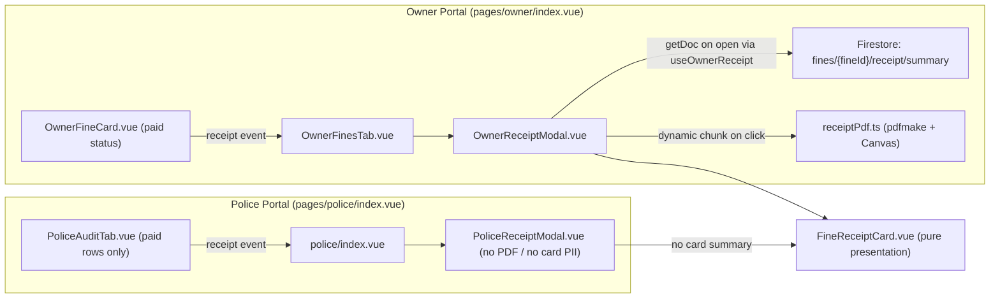

# ParkAlert Fine Receipt Preview, PDF Download & Police Verification

*   **Author:** BrahimMasmoudi
*   **Status:** Proposed
*   **Date:** 2026-11-24

--------------------------------------------------------------------------------

## Overview

This design adds a ParkAlert fine payment receipt preview modal and `.pdf` export for vehicle owners on settled (`paid`) fines, formatted in French or English (with English fallback when the app is in Arabic) while preserving Arabic `cardholderName` and `notes` glyphs. It also adds a read-only **Receipt** verification button and modal on `paid` rows in the Police Audit Journal (alongside `paymentReference` and `fineId` search) without exposing owner cardholder details or download/print controls.

--------------------------------------------------------------------------------

## The Problem

1.  **No owner receipt preview or portable PDF export**: Settled fines already persist `paidAt`, `paymentReference`, and `paymentProvider` on `fines/{fineId}`, along with owner-only card metadata (`cardholderName`, `cardBrand`, `cardLast4`) under `fines/{fineId}/receipt/summary`, yet `OwnerFineCard.vue` displays only a static "Receipt Issued" indicator.
2.  **Police Audit Journal lacks payment verification detail**: `PoliceAuditTab.vue` renders basic columns (plate, owner, amount, status, issued timestamp) with no `paid`-row verification modal and searches only by vehicle plate and owner name rather than `paymentReference` or `fineId`.
3.  **Dual-role PII boundary risk**: Police accounts in ParkAlert hold dual `['police', 'owner']` roles. If Police Audit verification fetched `receipt/summary` or read from a shared store cache populated during owner sessions, officers auditing their own fines would expose cardholder PII inside the police portal.
4.  **Locale, BiDi, dark-mode, and PDF rendering pitfalls**: Official receipts use only English (`en`) or French (`fr`) template text (`ar` falls back to `en` inside an `LTR` layout), yet free-text `cardholderName` and violation `notes` allow Arabic/Unicode characters, `@nuxtjs/i18n` lazy-loads locale bundles, Tailwind CSS v4 `oklch()` colors break DOM-screenshot PDF tools, and dark mode applies dark surfaces across `@nuxt/ui` components unless the receipt sheet isolates light paper colors.

--------------------------------------------------------------------------------

## Goals

*   Allow vehicle owners with settled (`status === 'paid'`) fines to open a ParkAlert-branded receipt preview modal from `OwnerFineCard.vue` (hosted in `OwnerFinesTab.vue`).
*   Display all authoritative payment and violation details in the receipt: **ParkAlert** header, `PAID` settlement badge, `paymentReference`, short `#<LAST6>` and full `fineId`, vehicle `plateNumber`, optional violation `notes`, fine `issuedAt` and `paidAt` timestamps (`YYYY-MM-DD HH:mm UTC`), formatted amount (`TND <amount.toFixed(2)>`), and `Payment Channel` (`Simulated`), plus lazily loaded owner card metadata (`cardholderName`, `Card Network`, masked `•••• <cardLast4>`).
*   Export owner receipts directly as `.pdf` files with shaped, connected Arabic glyphs for `cardholderName` and `notes` in environments where an Arabic-capable web or system font loads.
*   Render receipt template labels and dates strictly in `fr` (when the app locale is `fr`) or `en` (`en`, `ar`, and fallback) inside an `LTR` layout while isolating `cardholderName` and `notes` directionality and displaying an English/French issuance notice when the app is in Arabic.
*   Add an `Actions` column to `PoliceAuditTab.vue` rendering a **Receipt** button exclusively on `paid` rows to open a read-only verification modal sourced strictly from `fines/{fineId}` (no cardholder PII, no download or print controls), and filter the audit list on `paymentReference` and `fineId`.
*   Keep `firestore.rules` and backend Cloud Functions unchanged, keep PDF bundle chunks out of police/boot bundles, and avoid eager N+1 Firestore reads across fine lists.

--------------------------------------------------------------------------------

## Non-Goals

*   Generating Arabic (`ar`) RTL receipt templates (Arabic text inside `cardholderName` and `notes` remains supported inside the EN/FR layout).
*   Supporting fallback receipts for historical pre-feature `paid` fines lacking `paymentReference` or `receipt/summary` metadata (environment is pre-launch development).
*   Modifying `firestore.rules`, adding backend Cloud Functions (`getReceipt` or server-side PDF rendering), or adding QR/cryptographic signatures.
*   Exposing `cardholderName`, `cardBrand`, `cardLast4`, or download/print buttons in the Police Audit Journal.
*   Enforcing browser OS screenshot or native browser menu DRM; the police modal suppresses browser print output of the modal dialog while keeping cardholder PII strictly absent from the police portal.

--------------------------------------------------------------------------------

## Open Questions

None.

--------------------------------------------------------------------------------

## Critical User Journeys (CUJs)

### CUJ 1: Owner Official Receipt Preview & PDF Download (`en` / `fr` / `ar` App Locales)

*   **Given**: An authenticated vehicle owner views a settled fine on the Owner Fines tab in English, French, or Arabic.
*   **When**: The owner selects **View Receipt**, reviews the ParkAlert preview modal, and selects **Download PDF**.
*   **Then**: The owner portal opens the receipt modal and fetches the owner-only card summary on demand; receipt copy renders in French (if app locale is `fr`) or English (`en` or `ar` fallback with an EN/FR notice banner) inside an LTR paper layout while preserving Unicode/Arabic `cardholderName` and `notes`; selecting Download saves `parkalert-receipt-<paymentReference>.pdf` with matching field order and readable Arabic/Latin text.

### CUJ 2: Police Audit Journal Payment Verification

*   **Given**: An authenticated police officer inspects the Audit Journal table.
*   **When**: The officer searches by plate, owner, fine ID, or `paymentReference`, views rows across `unpaid`, `paid`, and `cancelled` statuses, and selects **Receipt** on a `paid` row.
*   **Then**: Only `paid` rows show the **Receipt** action button; clicking it opens a read-only verification modal containing strictly settlement fields (`paymentReference`, short/full fine ID, `plateNumber`, `amount`, `status`, `issuedAt`, `paidAt`, `Payment Channel`, and optional violation `notes`) with zero cardholder PII (`cardholderName`, `cardBrand`, `cardLast4`) and no download or print buttons—even if the officer holds dual `['police', 'owner']` roles and views their own fine.

### CUJ 3: Missing Metadata, Transient Fetch Error & Rapid Modal Switching

*   **Given**: The owner selects **View Receipt** on a `paid` fine while offline, when `receipt/summary` is missing, or while switching rapidly between multiple paid fines.
*   **When**: The card summary fetch is in flight, fails transiently, finds no summary document, or finishes after switching to another fine.
*   **Then**: In-flight loading renders a skeleton block with **Download PDF** disabled until the check settles; transient errors show an actionable **Retry** button and missing/unavailable summaries display `"Card payment details unavailable"`, while still allowing Download of the authoritative settlement receipt (unless `paymentReference` itself is missing); stale responses from previously closed modals are discarded, and no card summary stays cached across modals or routes.

--------------------------------------------------------------------------------

## Technical Plan (Architecture)

### 1. Data Flow, Role Isolation, & Modal Lifecycle



*   **Strict Component & Composable Separation**: `OwnerReceiptModal.vue` fetches `fines/{fineId}/receipt/summary` solely through an owner-exclusive composable (`useOwnerReceipt`) that holds no shared store cache and verifies the active user UID before and after reading Firestore. Neither `useFinesStore` nor any Police component imports `useOwnerReceipt` or references cardholder metadata, preventing stale dual-role PII retention across owner-to-police navigation.
*   **Single Source of Structural Truth**: Both HTML preview (`FineReceiptCard.vue`) and PDF document (`receiptPdf.ts`) render from one normalized ordered row list produced by `buildReceiptViewModel`, preventing label, formatting, or field-order divergence.
*   **Modal Lifecycle Isolation**:
    *   `OwnerFineCard.vue` replaces the static `receipt_issued` label on paid fines with a **View Receipt** action handled by `OwnerFinesTab.vue`, which mounts a single hoisted `OwnerReceiptModal.vue` with a request nonce so rapid fine switching ignores stale responses.
    *   `police/index.vue` converts audit table headers to localized reactive labels with an `Actions` column, filters `filteredAllFines` specifically by `paymentReference` and `fineId` alongside plate and owner name (`userStore.usersCache`), and binds a direct `selectedAuditReceiptFine` ref for `PoliceReceiptModal.vue`.

### 2. Localization, BiDi Isolation, & Light-Paper Protection

*   **Shared JSON Receipt Copy**: `receiptPdf.ts` imports `en.json` and `fr.json` statically so `en`/`fr` receipt templates and date formatters execute synchronously regardless of app locale (`lazy: true`) or test runtime (`Vitest` Node environment), while keeping one translation source of truth across modal chrome and PDF output. When the app runs in `fr`, receipts render in French; for `en`, `ar`, or any other locale, receipts render in English inside an `LTR` sheet with a brief English/French notice banner (`ar` only).
*   **Formatting Normalization**:
    *   Timestamps render strictly in `UTC` (`YYYY-MM-DD HH:mm UTC`, matching `PA-YYYYMMDD` payment references); missing or invalid timestamps display `'—'` instead of falling back to current client time.
    *   Monetary values render as `TND <amount.toFixed(2)>`; payment channels map `'simulated'` to `'Simulated'` / `'Simulé'`; card brands map cleanly to `'Visa'`, `'Mastercard'`, `'American Express'`, and `'Discover'`.
*   **BiDi & Dark-Mode Protection**: All displayed text (`cardholderName`, violation `notes`, `plateNumber`, `paymentReference`, `fineId`) strips directional control marks and non-printable C0/C1 characters on read (falling back to `'—'` if empty). `FineReceiptCard.vue` uses explicit light-paper colors (`bg-white text-slate-900`) independent of the app's dark mode, locks the receipt frame to `LTR`, and isolates `cardholderName` and `notes` in `dir="auto"` elements.

### 3. On-Demand Client PDF Generation (`pdfmake` + Non-Latin Canvas Fallback)

*   **Bundle Isolation**: Clicking **Download PDF** dynamically imports `pdfmake` and its font bundle exclusively inside the Owner flow so Police and Agent bundles carry zero PDF library weight and incur zero boot-time bundle cost.
*   **Document Layout**: Reproduces the **ParkAlert** header, `PAID` badge, prominent `paymentReference`, ordered metadata rows (matching `FineReceiptCard.vue`), optional masked Card Summary block, and simulated-payment footer notice.
*   **Mixed Vector & Arabic Glyph Handling**: An Arabic-capable web font (`Noto Sans Arabic`) is declared in app CSS and awaited prior to offscreen measurement. If both `cardholderName` and `notes` contain only vector-safe ASCII/Latin-1 printable glyphs, they render as selectable vector text; if either contains Arabic or extended glyphs (`œ`, `€`, `’`), the offscreen high-DPI Canvas helper renders that formatted block (with explicit per-string `LTR`/`RTL` direction and multi-line wrapping up to the cell width) as an embedded PNG image. Any Canvas failure during non-Latin export raises a typed error caught by a failure toast rather than silently exporting empty-box glyphs.

### 4. Police Audit Verification & Read-Only Guardrails

*   `PoliceAuditTab.vue` renders a compact **Receipt** button in the Actions column strictly on `status === 'paid'` rows (`'—'` on unpaid/cancelled rows).
*   `PoliceReceiptModal.vue` displays `FineReceiptCard.vue` with no card summary prop, no Download/Print actions, and modal-portal `@media print` suppression.

### 5. End-to-End Sequences

```mermaid
sequenceDiagram
    actor Owner
    participant Card as OwnerFineCard.vue
    participant Tab as OwnerFinesTab.vue
    participant Modal as OwnerReceiptModal.vue
    participant Composable as useOwnerReceipt
    participant DB as Firestore (receipt/summary)
    participant PDF as receiptPdf.ts (pdfmake + Canvas)

    Owner->>Card: Click View Receipt (status === 'paid')
    Card->>Tab: emit('receipt', fine)
    Tab->>Modal: Open modal (fine, nonce++)
    Modal->>Composable: fetchReceiptSummary(fine.id, uid)
    Composable->>DB: getDoc(fines/{fineId}/receipt/summary)
    DB-->>Composable: snapshot
    alt Exists & valid & uid unchanged
        Composable-->>Modal: { status: 'ready', summary }
    else Missing / Invalid Shape
        Composable-->>Modal: { status: 'missing' } (allow settlement PDF)
    else Network / Permission Error
        Composable-->>Modal: error state (Retry or settlement PDF)
    end
    Modal->>Modal: Discard if nonce mismatch; build viewModel (ar->en LTR)
    Owner->>Modal: Click Download PDF
    Modal->>PDF: loadPdfMake() + downloadReceiptPdf(pdfMake, viewModel)
    alt Non-WinAnsi cardholderName or notes
        PDF->>PDF: Render wrapped text on high-DPI Canvas -> PNG
    end
    PDF-->>Owner: Save parkalert-receipt-{safeRef}.pdf
```

--------------------------------------------------------------------------------

## Alternatives Considered

### Alternative A: Eager Per-Row `receipt/summary` Subscription or Global Pinia Cache

*   **Pros**: Opening a settled fine's receipt modal would have card summary data cached before clicking View Receipt.
*   **Cons**: Under `firestore.rules`, each `fines/{fineId}/receipt/summary` read executes both `users/{uid}` and parent `fines/{fineId}` lookups (`3` Firestore reads per document). Eager subscriptions multiply reads across the entire list, while holding cardholder PII in a global Pinia store (`useFinesStore`) risks retaining PII across `/owner` to `/police` switches for dual-role officers.
*   **Reason for Rejection**: Fetching via modal-scoped `useOwnerReceipt` (`getDoc` on open, discarded on close) avoids N+1 reads and eliminates cross-portal PII persistence.

### Alternative B: Server-Side Receipt Endpoint / Puppeteer Cloud Function

*   **Pros**: Centralizes PDF rendering on the backend using headless Chromium or server font libraries, shifting CPU/bundle overhead off the browser SPA.
*   **Cons**: Requires deploying a new Cloud Function with larger container memory/cold-start latency, increases Firebase Cloud Functions compute billing, and duplicates reads of `fines/{fineId}` + `receipt/summary` already accessible directly through `firestore.rules`.
*   **Reason for Rejection**: Existing Firestore security rules already isolate `receipt/summary` to the vehicle owner and `fines/{fineId}` to police/owners, avoiding Cloud Function cold-start latency and per-invocation compute charges.

### Alternative C: Browser-Native `window.print()` / `@media print` Only

*   **Pros**: Zero new dependencies, single HTML layout (`FineReceiptCard.vue`), native Tailwind v4 `oklch()` rendering, and native HarfBuzz Arabic text shaping.
*   **Cons**: Relies on users knowing how to choose "Save as PDF" in OS print dialogs instead of delivering an immediate `.pdf` file download, and varies in header/margin presentation across browsers.
*   **Reason for Rejection**: Product requirements explicitly specify direct `.pdf` file download (`parkalert-receipt-<paymentReference>.pdf`).

### Alternative D: Single Role-Parameterized `ReceiptModal` Shared Between Owner and Police

*   **Pros**: Avoids creating two modal wrapper files (`OwnerReceiptModal.vue` and `PoliceReceiptModal.vue`).
*   **Cons**: Coupling PII fetching (`useOwnerReceipt`), PDF download imports, and police verification inside one stateful modal creates regression risk—especially because police officers carry dual `['police', 'owner']` tokens that pass owner Firestore rules if auditing their own fine.
*   **Reason for Rejection**: Rejected to enforce structural separation: only the pure stateless presentation core (`FineReceiptCard.vue` and `buildReceiptViewModel`) is shared, while Owner and Police modals remain strictly decoupled.

### Alternative E: `@sidebase/nuxt-pdf`, `html2canvas`, or Global `nuxt-pdfmake` Registration

*   **Pros**: Captures styled DOM directly (`@sidebase/nuxt-pdf` / `html2canvas`) or auto-registers `pdfmake` via a Nuxt module.
*   **Cons**: `@sidebase/nuxt-pdf` (`1.0.0-alpha.0`) is an unmaintained early Nuxt 3 alpha module lagging Nuxt 4 (`^4.6.4`), and `html2canvas` fails on Tailwind CSS v4 `oklch()` color tokens; meanwhile, registering `'nuxt-pdfmake'` as a global Nuxt module bundles ~750 KB+ of `pdfmake`/Roboto VFS into boot chunks shared with Police and Agent portals.
*   **Reason for Rejection**: Dynamic `import('pdfmake/build/pdfmake')` on Download keeps PDF chunks completely isolated from initial SPA boot and Police routes while delivering crisp vector PDFs.

### Alternative F: Bundled Arabic TTF + Reshaper vs. Scoped Canvas Snippet

*   **Pros**: Keeping 100% vector text inside `pdfmake` (including Arabic `cardholderName` and `notes`) makes every field selectable in PDF readers without PNG embedding.
*   **Cons**: Standard `pdfmake` Roboto drops Arabic glyphs (`□`), and embedding raw Arabic TTF fonts disconnects Arabic letters unless paired with a heavy TTF bundle (~300 KB–1 MB+) plus JS BiDi/reshaping dependencies.
*   **Reason for Rejection**: Dynamic `pdfmake` vector text for **ParkAlert** EN/FR structure combined with an offscreen Canvas PNG snippet exclusively when `cardholderName` or `notes` contains non-vector-safe glyphs avoids heavy TTF bundles on Latin receipts while handling Arabic shaping properly.

### Alternative G: Duplicated TypeScript Dictionary or Dynamic `useI18n()` Lookup

*   **Pros**: Calling `t(..., { locale: 'en' })` reuses runtime i18n without static imports, while an inline TypeScript dictionary skips locale file lookups.
*   **Cons**: Lazy loading (`i18n.lazy: true`) may leave `en.json` unloaded during `ar` sessions, and duplicating strings in TypeScript diverges from `en.json`/`fr.json`.
*   **Reason for Rejection**: Statically importing `en.json` and `fr.json` in `receiptPdf.ts` provides synchronous lookup across all app locales and tests from a single source of truth.

--------------------------------------------------------------------------------

## Non-Functional Requirements

*   **Security & Privacy**:
    *   `PoliceReceiptModal.vue`, `PoliceAuditTab.vue`, `police/index.vue`, and `useFinesStore` must never import `useOwnerReceipt`, query `fines/{fineId}/receipt/summary`, or hold `cardholderName`, `cardBrand`, or `cardLast4`.
    *   `useOwnerReceipt` validates active user UID before and after Firestore `getDoc`, stores no cross-modal cache in Pinia, and modal state clears on unmount.
    *   Strip Unicode BiDi control characters and C0/C1 control characters from all receipt text prior to preview and PDF/Canvas drawing, and never construct markup with `innerHTML`.
*   **Performance & Bundle Footprint**:
    *   `OwnerFinesTab.vue` executes zero extra Firestore reads until an owner selects **View Receipt** on a `paid` fine.
    *   `pdfmake` and `vfs_fonts` load strictly via dynamic `import()` on **Download PDF** click (`ssr: false`), contributing zero bytes to entry chunks or `/police` routes.
*   **Rollout & Compatibility**:
    *   Requires installing `pdfmake` and `@types/pdfmake` plus Arabic `@font-face` rules in `front/` alongside existing Firebase Hosting deployment (`front/.output/public`); zero Cloud Functions or `firestore.rules` deployments required.

--------------------------------------------------------------------------------

## Risks & Mitigations

*   **Dual-Role Officer Auditing Own Fine (`['police', 'owner']`)**: A police officer viewing their own fine in `PoliceAuditTab.vue` passes Firestore rules for `receipt/summary` if an audit modal attempts the fetch. **Mitigation**: Enforce structural isolation—`PoliceReceiptModal.vue` accepts only `Fine` and never imports `useOwnerReceipt`.
*   **Arabic Font Availability & Long Free Text on Canvas**: Headless Linux or minimal devices lacking system Arabic fonts render fallback `□` boxes if relying passively on OS fonts, and long 100-char names shrink if constrained to one line. **Mitigation**: Configure `'Noto Sans Arabic'` `@font-face` in `front/app/assets/css/main.css`, await `document.fonts.load(...)`, set explicit per-string `ctx.direction`, wrap multi-line text inside the table cell width, and raise a typed error caught by a toast if Canvas returns `null`.
*   **Print / Copy Leakage on Police Verification Modal**: Hiding buttons does not stop OS screenshots. **Mitigation**: Apply `@media print` suppression directly on the `<UModal>` portal container (`no-print-modal`) while keeping cardholder PII strictly absent from DOM and memory.
*   **Unbounded `allFinesQuery` Growth in Police Audit**: `allFinesQuery` currently subscribes to the full `fines` collection (~1,000-row comfortable SPA limit) alongside per-owner profile lookups (`userStore.fetchUser`). **Mitigation**: Document the ~1,000-fine client limit; once collection growth requires pagination/limits, replace client-side `paymentReference` filtering with an indexed Firestore `where('paymentReference', '==', ...)` query.
*   **Missing `receipt/summary` or Payment Fields on Dev Documents**: Seeded emulator documents may lack `receipt/summary` or payment timestamps. **Mitigation**: Handle missing `paidAt`/`issuedAt` safely (`'—'` on optional missing dates), permit settlement-only PDF export with `"Card payment details unavailable"` when `receipt/summary` is missing/errored (while keeping Retry on errors), and disable Download if `paymentReference` is missing.

--------------------------------------------------------------------------------

## Detailed Implementation Plan

### Target Scope & File Boundary
Only the following frontend/config files and tests are created or modified (zero backend Cloud Functions or `firestore.rules` changes):
*   **Config & Styling:** `front/package.json`, `front/pnpm-lock.yaml`, `front/nuxt.config.ts`, `front/app/assets/css/main.css`
*   **Utilities, Composable & Store:** `front/app/utils/receiptPdf.ts` (create), `front/app/composables/useOwnerReceipt.ts` (create), `front/app/stores/fines.ts`
*   **Components & Pages:** `front/app/components/molecules/FineReceiptCard.vue` (create), `front/app/components/organisms/OwnerReceiptModal.vue` (create), `front/app/components/molecules/OwnerFineCard.vue`, `front/app/components/organisms/OwnerFinesTab.vue`, `front/app/components/organisms/PoliceReceiptModal.vue` (create), `front/app/components/organisms/PoliceAuditTab.vue`, `front/app/pages/police/index.vue` (`front/app/pages/owner/index.vue` read-only reference for `definePageMeta({ role: 'owner' })`)
*   **Localization & Tests:** `front/i18n/locales/en.json`, `front/i18n/locales/fr.json`, `front/i18n/locales/ar.json`, `front/tests/receiptPdf.test.ts` (create), `front/tests/ownerReceipt.test.ts` (create), `front/tests/fineConverter.test.ts`

### Unified Implementation Tasks

#### 1. `front/package.json`, `front/pnpm-lock.yaml`, `front/nuxt.config.ts`, & `front/app/assets/css/main.css` (Modify)
*   **Type / Scope**: Dynamic PDF Dependencies, Arabic Web Font, & Print Suppression Styles
*   **Proposed Changes**:
    *   Install `pdfmake` (`pnpm add pdfmake`) and TypeScript types (`pnpm add -D @types/pdfmake`) in `front/`. Do NOT register `'nuxt-pdfmake'` as a global Nuxt module so `pdfmake`/VFS stays excluded from entry and `/police` chunks.
    *   Configure Arabic web-font support (`'Noto Sans Arabic'`) in `front/app/assets/css/main.css` (e.g., `@font-face` or `@nuxt/fonts` link in `front/nuxt.config.ts`) so offscreen Canvas Arabic shaping works consistently across platforms.
    *   Add declarative `@media print` suppression in `front/app/assets/css/main.css`:
        `@media print { body:has(.no-print-modal) { visibility: hidden !important; } .no-print-modal { display: none !important; } }` (no manual `document.body.classList` state).

#### 2. `front/app/utils/receiptPdf.ts` (Create)
*   **Type / Scope**: Pure TypeScript View-Model, Shared JSON Dictionary, & Dynamic PDF Builder (Vitest `node`-safe)
*   **Proposed Changes**:
    *   Import `enLocale` from `../../i18n/locales/en.json` and `frLocale` from `../../i18n/locales/fr.json` statically.
    *   Export types: `ReceiptLocale = 'en' | 'fr'`, `ReceiptSummaryState = 'idle' | 'loading' | 'ready' | 'missing' | 'error'`, `ReceiptCopyBlock`, `ReceiptFieldRow` (`{ key: string; label: string; value: string; isolateAuto?: boolean }`), `FineReceiptViewModel`, `CanvasSnippetAdapter`, `PdfMakeLike`, and `ReceiptPdfRenderError`.
    *   Implement `resolveReceiptLocale(appLocale: string): ReceiptLocale`: returns `'fr'` when `appLocale === 'fr'`, and `'en'` otherwise (`'en'`, `'ar'`, or fallback).
    *   Implement `buildReceiptCopy(receiptLocale: ReceiptLocale): ReceiptCopyBlock` sourcing labels from `enLocale.receipt` / `frLocale.receipt`, `owner.fines.payment_modal.brands.*`, `police.audit.paid`, and `common.*`.
    *   Implement `sanitizeReceiptText(value: unknown): string`: trims and strips Unicode BiDi characters (`U+200E`, `U+200F`, `U+061C`, `U+202A`–`U+202E`, `U+2066`–`U+2069`) plus C0 (`<= 0x1F`) and C1 (`0x7F`–`0x9F`) controls cleanly (complementing `validateCardholderName` input validation in `front/app/composables/useCardValidation.ts`), returning `'—'` if empty.
    *   Implement `isPdfVectorSafeText(value: string): boolean`: returns `true` only when every character code is printable ASCII (`0x20`–`0x7E`) or printable Latin-1 (`0xA0`–`0xFF`); extended glyphs (`œ`, `€`, `’`, Arabic) return `false`.
    *   Implement `detectTextDirection(value: string): 'rtl' | 'ltr'` using first strong RTL Unicode script matching (`[\u0591-\u07FF\uFB1D-\uFDFD\uFE70-\uFEFC]`).
    *   Implement `buildReceiptViewModel(fine: Fine, receiptSummary: FineReceiptSummary | null, appLocale: string): FineReceiptViewModel`:
        *   Formats `fineReference` (`#${fine.id.slice(-6).toUpperCase()}` matching `OwnerFineCard.vue:15`) and full sanitized `fineId`.
        *   Formats `issuedAtFormatted` and `paidAtFormatted` strictly in `UTC` (`Intl.DateTimeFormat` with `timeZone: 'UTC'` producing `YYYY-MM-DD HH:mm UTC` without Eastern Arabic digits `٠–٩`); renders `'—'` if missing or `!Number.isFinite(...)`.
        *   Formats `amountFormatted` (`TND ${fine.amount.toFixed(2)}`), `paymentProviderLabel` (`'Simulated'` / `'Simulé'` when `'simulated'`, else sanitized value or `'—'`), and `cardBrandLabel` (`'Visa'`, `'Mastercard'`, `'American Express'`, `'Discover'`).
        *   Emits ordered `rows: ReceiptFieldRow[]` (`Fine Reference`, `Fine ID`, `License Plate`, `Issued Date`, `Payment Date (UTC)`, `Payment Channel`, optional `Violation Notes` when non-empty after trim) consumed identically by `FineReceiptCard.vue` and `buildReceiptDocDefinition`.
    *   Implement `renderTextSnippetPng(text: string, adapter?: CanvasSnippetAdapter): Promise<{ dataUrl: string; width: number; height: number } | null>`: waits on `document.fonts?.load('14px "Noto Sans Arabic", sans-serif')`, configures `ctx.direction = detectTextDirection(text)`, wraps multi-line lines up to the table cell width (`~280pt`) with `#ffffff` fill and `#0f172a` ink.
    *   Implement `async buildReceiptDocDefinition(viewModel: FineReceiptViewModel, canvasAdapter?: CanvasSnippetAdapter): Promise<TDocumentDefinitions>` (typed via `@types/pdfmake`): builds header (**ParkAlert** + `PAID` badge + `paymentReference`), key-value metadata table from `viewModel.rows`, highlighted `Total Paid` (`amountFormatted`), optional Card Summary block (`cardholderName`, `cardBrandLabel`, `•••• <cardLast4>`), and simulation footer notice. Any `viewModel.rows` value (e.g., `notes`) or `cardholderName` failing `isPdfVectorSafeText` triggers `renderTextSnippetPng`; if `renderTextSnippetPng` resolves to `null`, throws `new ReceiptPdfRenderError(...)`.
    *   Implement `sanitizeFilenameSegment(value: string): string` (keeping `[A-Za-z0-9_-]`, fallback `'receipt'`), `async loadPdfMake(): Promise<PdfMakeLike>` (dynamically importing `'pdfmake/build/pdfmake'` and `'pdfmake/build/vfs_fonts'`), and `async downloadReceiptPdf(pdfMake: PdfMakeLike, viewModel: FineReceiptViewModel, filename?: string, canvasAdapter?: CanvasSnippetAdapter): Promise<void>` exporting `parkalert-receipt-${safeRef}.pdf` via `.getBlob()` + object-URL `<a download>` (cleanly awaited inside `try/catch/finally`).

#### 3. `front/app/composables/useOwnerReceipt.ts` (Create) & `front/app/stores/fines.ts` (Modify)
*   **Type / Scope**: Owner-Isolated Receipt Fetcher & Store Timestamp Hygiene
*   **Proposed Changes**:
    *   **`front/app/stores/fines.ts`**:
        *   Export `FineReceiptSummary = { cardholderName: string; cardBrand: CardBrand; cardLast4: string }`.
        *   Fix `getTimestampMillis(ts: any): number` so `typeof ts?.seconds === 'number'` and `typeof ts?._seconds === 'number'` handle epoch `0` cleanly (preventing `NaN` when seconds is `0`), keeping `Date.now()` fallback strictly for missing/non-finite required `issuedAt`.
        *   Add `getOptionalTimestampMillis(ts: any): number | undefined` returning `undefined` whenever `!ts` or computed milliseconds is `!Number.isFinite(ms)`, and apply it to `paidAt`, `disputedAt`, and `resolvedAt` in `normalizeFineFromFirestore`. Do NOT add `receiptSummaryCache`, `watch`, `doc`, or `getDoc` to `fines.ts`.
    *   **`front/app/composables/useOwnerReceipt.ts`**:
        *   Implement owner-exclusive `fetchReceiptSummary(fineId: string, expectedUid: string): Promise<{ status: 'ready'; summary: FineReceiptSummary } | { status: 'missing' }>`:
        *   Verifies `expectedUid` and `authStore.currentUser?.uid === expectedUid` pre- and post-`await` (plus throws if unauthenticated).
        *   Executes `getDoc(doc(db, 'fines', fineId, 'receipt', 'summary'))`. If `!snap.exists()` or fields fail validation (`typeof cardholderName === 'string' && trimmed.length > 0`, `cardBrand` in `['visa', 'mastercard', 'amex', 'discover']`, `typeof cardLast4 === 'string' && /^\d{4}$/.test(cardLast4)`), returns `{ status: 'missing' }`. Throws network/permission errors to caller.

#### 4. `front/app/components/molecules/FineReceiptCard.vue` (Create)
*   **Type / Scope**: Pure Presentational Receipt Card Molecule
*   **Proposed Changes**:
    *   Props: `viewModel: FineReceiptViewModel`, `copy: ReceiptCopyBlock`, optional `summaryState?: ReceiptSummaryState`; Emits: `(e: 'retry'): void`.
    *   Enforces an explicit light-paper card (`bg-white text-slate-900 border border-slate-200 rounded-xl`, muted labels `text-slate-600`, light-tinted `PAID` badge) inside `dir="ltr"` and `:lang="viewModel.locale"` so dark mode (`html.dark`) never degrades contrast.
    *   Iterates `viewModel.rows` identically to PDF generation, setting `dir="auto"` (`style="unicode-bidi: isolate"`) on isolated free-text cells (`notes`, `cardholderName`).
    *   When `summaryState` is provided (Owner mode): skeleton placeholder on `'loading'`, `$t('owner.fines.receipt_modal.summary_missing')` alert (`dir="auto"`) on `'missing'`, `$t('owner.fines.receipt_modal.summary_error')` alert (`dir="auto"`) + Retry button (`@click="emit('retry')"`) on `'error'`, and masked card details on `'ready'`.

#### 5. `front/app/components/organisms/OwnerReceiptModal.vue` (Create)
*   **Type / Scope**: Owner Receipt Preview & PDF Export Organism
*   **Proposed Changes**:
    *   Model / Props: `open = defineModel<boolean>('open', { required: true })`, `defineProps<{ fine: Fine | null }>()`.
    *   Uses `useOwnerReceipt().fetchReceiptSummary(...)` directly (zero `useFinesStore` PII cache).
    *   When `locale.value === 'ar'`, renders `<UAlert>` displaying `$t('owner.fines.receipt_modal.arabic_fallback_notice')` (no in-modal EN/FR override switcher).
    *   Watches `[open, () => props.fine?.id]` with `{ immediate: true }`: when `open` becomes `true` with a `paid` fine, increments `activeRequestNonce`, resets prior `receiptSummary = null`, sets `summaryState = 'loading'`, invokes `fetchReceiptSummary(fine.id, uid)`, ignores stale resolutions if `!open.value || nonce !== activeRequestNonce`, and sets `'ready'` / `'missing'` / `'error'`. Wires `@retry="loadSummary"` on `<MoleculesFineReceiptCard>`. Avoids wiping displayed content while `open` is fading out during the parent's `300ms` close animation (`onBeforeUnmount` cleans up).
    *   Footer buttons: Close (`$t('common.close')`) and **Download PDF** (`:loading="downloading"`, `:disabled="downloading || summaryState === 'loading' || !hasPaymentReference"`), invoking `loadPdfMake()` + `downloadReceiptPdf(...)` inside `try/catch/finally` with `useToast().add({ color: 'error', ... })` on any failure.

#### 6. `front/app/components/molecules/OwnerFineCard.vue` & `front/app/components/organisms/OwnerFinesTab.vue` (Modify)
*   **Type / Scope**: Owner Card Trigger & Modal Host
*   **Proposed Changes**:
    *   `OwnerFineCard.vue`: Extend `defineEmits` with `(e: 'receipt', fine: Fine): void`; replace the static `receipt_issued` `<div>` on `fine.status === 'paid'` with `<UButton color="neutral" variant="outline" size="sm" icon="i-lucide-file-text" :label="$t('owner.fines.receipt_modal.open_button')" @click="emit('receipt', fine)" />`.
    *   `OwnerFinesTab.vue`: Bind `@receipt="handleOpenReceiptModal"` on `paidFines` `<MoleculesOwnerFineCard>` items, manage independent `isReceiptModalOpen`, `selectedReceiptFineId`, and `receiptClearTimer` (`300ms` cleared in `onBeforeUnmount`), and mount `<OrganismsOwnerReceiptModal v-model:open="isReceiptModalOpen" :fine="activeReceiptFine" />` outside `v-for`.

#### 7. `front/app/components/organisms/PoliceReceiptModal.vue`, `front/app/components/organisms/PoliceAuditTab.vue`, & `front/app/pages/police/index.vue` (Create / Modify)
*   **Type / Scope**: Police Read-Only Payment Verification Modal & Audit Table Actions
*   **Proposed Changes**:
    *   Create `PoliceReceiptModal.vue`: accepts `open` model and `fine: Fine | null`; renders `<UModal v-model:open="open" :ui="{ content: 'no-print-modal' }" ...>`; builds `FineReceiptViewModel` with `receiptSummary = null` (`summaryState` omitted, never importing `useOwnerReceipt` or `pdfmake`); displays `MoleculesFineReceiptCard` + `$t('police.audit.verification_only_notice')`, optional `arabic_fallback_notice` when `locale === 'ar'`, and a single Close footer button.
    *   Update `PoliceAuditTab.vue`: type `columns: TableColumn<Fine>[]` and `fines: Fine[]`, add `defineEmits<{ (e: 'receipt', fine: Fine): void }>()`, and add `<template #actions-cell="{ row }">` rendering `<UButton v-if="row.original.status === 'paid'" size="xs" color="neutral" variant="soft" icon="i-lucide-receipt-text" :label="$t('police.audit.view_receipt_button')" @click="emit('receipt', row.original)" />` and `<span v-else class="text-muted">—</span>`.
    *   Update `front/app/pages/police/index.vue`:
        *   Make `auditColumns` a reactive `computed<TableColumn<Fine>[]>(() => [...])` using `t('police.audit.columns.plate')`, `owner`, `amount`, `status`, `issued`, and `{ id: 'actions', header: t('police.audit.columns.actions') }`.
        *   Keep shared `filterList` unchanged for cars/reports/disputes; implement dedicated filtering inside `filteredAllFines` using `const q = searchQuery.value.trim().toLowerCase()` matching `plateNumber`, cached owner name (`userStore.usersCache`), `fine.id`, and `fine.paymentReference`.
        *   Host `PoliceReceiptModal.vue` directly with `selectedAuditReceiptFine = ref<Fine | null>(null)` and `isAuditReceiptOpen = computed(...)` (matching existing simple modal patterns in `police/index.vue`).

#### 8. `front/i18n/locales/en.json`, `front/i18n/locales/fr.json`, `front/i18n/locales/ar.json` (Modify)
*   **Type / Scope**: Shared Receipt Dictionary & UI Chrome Keys
*   **Proposed Changes**:
    *   Add top-level `"receipt"` section to `en.json` and `fr.json` (`title`, `issued_by`, `paid_badge`, `payment_reference`, `fine_reference`, `fine_id`, `plate_number`, `issued_at`, `paid_at`, `payment_channel`, `simulated_channel`, `notes`, `total_paid`, `card_section_title`, `cardholder`, `card_network`, `card_last4`, `simulated_footer`).
    *   Add across `en.json`, `fr.json`, and `ar.json`:
        *   `owner.fines.receipt_modal`: `open_button`, `title`, `description`, `download_button`, `downloading_button`, `arabic_fallback_notice`, `summary_missing`, `summary_error`, `retry_button`, `download_error_title`, `download_error_desc`.
        *   `police.search_placeholder`: update placeholder copy to mention plate, owner, agent, fine ID, and payment reference.
        *   `police.audit.columns`: `plate`, `owner`, `amount`, `status`, `issued`, `actions`.
        *   `police.audit`: `view_receipt_button`, `receipt_modal_title`, `receipt_modal_desc`, `verification_only_notice`.

#### 9. `front/tests/receiptPdf.test.ts` (Create), `front/tests/ownerReceipt.test.ts` (Create), & `front/tests/fineConverter.test.ts` (Modify)
*   **Type / Scope**: Frontend Unit Tests (Vitest `environment: 'node'`)
*   **Proposed Changes**:
    *   Create `front/tests/receiptPdf.test.ts` testing:
        *   `resolveReceiptLocale`: `'fr' -> 'fr'`, `'en' -> 'en'`, `'ar' -> 'en'`, `'unknown' -> 'en'`.
        *   `buildReceiptCopy` parity between `'en'` and `'fr'` sourced from `en.json`/`fr.json` (all keys non-empty).
        *   `sanitizeReceiptText`: strips `U+200E`, `U+200F`, `U+061C`, `U+202A–U+202E`, `U+2066–U+2069`, C0/C1 controls, and falls back to `'—'` when empty while preserving Arabic letters.
        *   `isPdfVectorSafeText` (`'Amira Ben Salah' -> true`, `'Café' -> true`, `'L’œil 10€' -> false`, `'أميرة بن صالح' -> false`, `'a\u0085b' -> false`).
        *   `detectTextDirection` (`'أميرة'` -> `'rtl'`, `'John'` -> `'ltr'`).
        *   `buildReceiptViewModel`: ordered `rows`, UTC timestamps (`YYYY-MM-DD HH:mm UTC`), `TND 120.00`, missing/non-finite `paidAt` -> `'—'`, `receiptSummary === null` omits all card properties.
        *   `buildReceiptDocDefinition`: **ParkAlert** header present, `rows` parity with viewModel, Latin `cardholderName`/`notes` emit vector nodes without invoking Canvas adapter, Arabic `cardholderName` **or** Arabic/extended `notes` invokes `CanvasSnippetAdapter` and embeds `{ image }`, and `CanvasSnippetAdapter` returning `null` throws `ReceiptPdfRenderError`.
        *   `sanitizeFilenameSegment` and async `downloadReceiptPdf` (`.getBlob()` / download trigger, error propagation when `pdfMake` fails).
    *   Create `front/tests/ownerReceipt.test.ts` testing `useOwnerReceipt` (`ready`, `missing` on missing doc or malformed fields, UID mismatch pre-/post-`await`, Firestore error propagation).
    *   Update `front/tests/fineConverter.test.ts` (targeting `normalizeFineFromFirestore` in `front/app/stores/fines.ts`): verify `{ seconds: 0 }` converts to `0`, and missing or non-finite (`NaN`, `'invalid'`, `{}`) `paidAt`, `disputedAt`, and `resolvedAt` normalize to `undefined` instead of `Date.now()` or `NaN`.

### Verification Plan

*   **Dependencies, Typecheck, Tests & Build**:
    `cd front && pnpm run postinstall && pnpm exec tsc -p .nuxt/tsconfig.app.json --noEmit && pnpm test && pnpm run lint && pnpm run build`
    Inspect `front/.output/public/_nuxt/` build output to confirm `pdfmake` chunks are lazy-split and excluded from initial entry/police bundles.
*   **Cloud Functions & Rules Guard Check**:
    `cd functions && pnpm run test:unit` (Functions unit suite regression check) and verify `git status firestore.rules functions/` shows zero modifications.
*   **Manual UI & Emulator Verification**:
    *   **Owner Receipt Preview & Download (`en` / `fr` / `ar` + dark mode):** Settle a fine via `OwnerPayFineModal.vue` with a Latin cardholder name and a second fine with Arabic `cardholderName` and Arabic/extended `notes`. Inspect receipt modals across `en`, `fr`, `ar`, and dark mode (`html.dark`), confirming high-contrast light paper styling, EN fallback notice in `ar`, and readable `.pdf` downloads in macOS Preview / Chrome.
    *   **Missing / Offline Summary Edge State:** Disconnect network before opening an uncached receipt preview; confirm Retry works once back online and settlement-only PDF export succeeds when `receipt/summary` is missing (`exists() === false`) while `paymentReference` exists.
    *   **Police Audit Verification & Dual-Role Network Check:** Sign in as `police-1` (`['police', 'owner']`), confirm **Receipt** shows strictly on `paid` rows, filter by `paymentReference` (`PA-...`) and `fineId` (including trailing whitespace), open `PoliceReceiptModal.vue` on both another user's fine and `police-1`'s own paid fine while inspecting Chrome DevTools Network tab to confirm zero Firestore requests to `receipt/summary`, zero cardholder PII in DOM, and modal suppression in browser print preview (`Cmd+P`).

--------------------------------------------------------------------------------

*Drafted with EGM*
